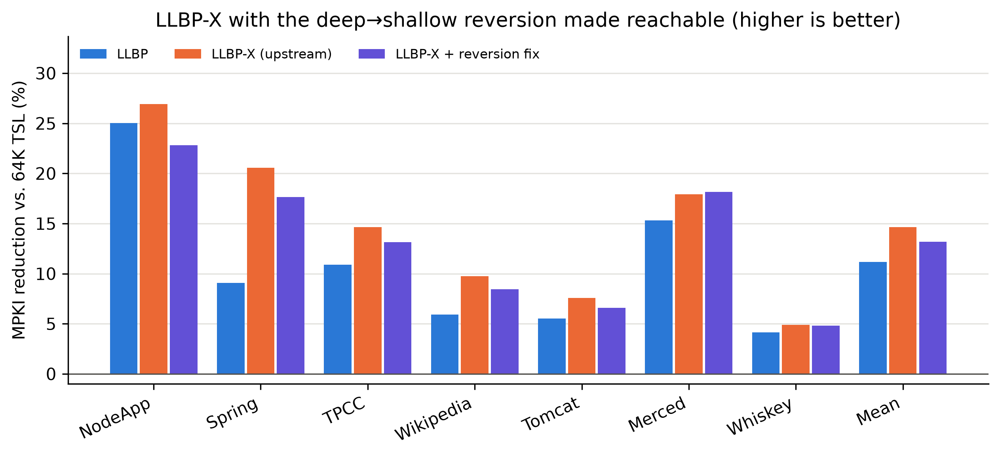

<div class="titlepage" markdown="1">

<h1 class="title">Should LLBP-X Contexts Return to Shallow Depth? <br/>Making the Deep→Shallow Transition Reachable</h1>

**Extension study of "The Last-Level Branch Predictor Revisited" (Schall, Ďuračková, Grot, HPCA 2026)**

Builds on the shared LLBP-X reproduction framework (see Section 7)

Report date: 16 November 2026

</div>

# Abstract

The LLBP-X paper states that a context switched to the deep context depth (W = 64) "can dynamically revert to the shallow W = 2" when its allocations become short, using a counter with hysteresis (§V-B.1). Inspecting the official artifact, we find that this transition is unreachable: the switching code runs only while a context is shallow, so deep contexts return to W = 2 only when their tracking-table (CTT) entry is evicted. We implement the behaviour the paper describes as an opt-in switch and evaluate it with the official simulator on seven server workloads (100 M warm-up + 200 M measured instructions, pattern-store latency modelled). **Making the reversion reachable worsens accuracy.** The mean MPKI reduction over a 64 KB TAGE-SC-L falls from 14.65 % to 13.17 % (+1.74 % MPKI relative to unmodified LLBP-X), and six of seven workloads get worse (NodeApp by 5.6 %, Spring by 3.7 %). The share of pattern allocations made in deep contexts drops from 29.7 % to 13.2 %. Contexts oscillate between depths and lose their patterns at every switch. In this setting the published code's one-way behaviour is the better design, and a reversion mechanism would need much stronger hysteresis than the paper's counter.

# 1. Background

LLBP-X tracks contended contexts in a 6K-entry Context Tracking Table (CTT). For each tracked context, a counter (`allocVsDrop` in the code) counts pattern allocations that favour the *other* depth: long allocations (history ≥ 232 bits) while shallow, or short ones (< 232 bits) while deep. When it exceeds 7, the context switches depth and the counter is reset. Every switch makes the patterns learned at the previous depth unreachable, so they must be retrained. The paper describes switching in both directions.

# 2. The discrepancy in the artifact

In `artifact/bpmodels/llbpx/llbpx.cc` (`LLBPX::llbpAllocate`), the switch is guarded as follows:

```cpp
if ((ci->fullPatternSets >= 0) && (ci->wi < nW-1)) {     // only while shallow (wi == 0)
    if (ci->allocVsDrop > th) {
        if (ci->wi == 0)          { ci->wi = nW-1; ci->allocVsDrop = 0; }   // 2 -> 64
        else if (ci->wi == nW-1)  { ci->wi = 0;    ci->allocVsDrop = 0; }   // 64 -> 2: unreachable
    }
}
```

Because of `ci->wi < nW-1`, the second branch can never run. A deep context therefore stays deep until LRU replacement evicts its CTT entry, after which it is untracked and falls back to W = 2.

**Research question:** does implementing the paper's two-way adaptation change accuracy, and in which direction?

# 3. Method

* **Change (marked `[PROJECT-MOD]`):** a new config flag `revertDepth` (default `false` = upstream behaviour). When it is `true`, the guard becomes `(revertDepth || ci->wi < nW-1)`, which makes the existing 64 → 2 branch reachable. Nothing else changes: same counter, same threshold (7) and same H<sub>th</sub> (232 bits). The new model is `llbpx-timing-revert` (`artifact/bpmodels/llbpx/llbpx.h`, `base_predictor.cc`).
* **Correctness check:** with the default flag, the binary reproduces the unmodified framework exactly on the official small test trace (43,552 mispredictions for 5 M + 20 M instructions).
* **Workloads (7 of the 14 official traces):** NodeApp, Spring, TPCC, Wikipedia, Tomcat, Merced and Whiskey.
* **Settings:** 100 M warm-up + 200 M measured instructions, `--simulate-btb`, pattern-store latency modelled. The 64K TSL, LLBP and unmodified LLBP-X results come from the shared framework's runs with identical settings.
* **Metrics:** conditional-branch MPKI, MPKI reduction vs 64K TSL, and the share of LLBP pattern allocations made in deep (W = 64) contexts. The latter comes from the simulator's `Hist alloc W` histogram and covers the whole run including warm-up, because that histogram is not reset after warm-up.

Commands:
```bash
scripts/run_experiments.sh -m "llbpx-timing-revert" \
  -t "nodeapp-nodeapp dacapo-spring benchbase-tpcc benchbase-wikipedia dacapo-tomcat merced.467915 whiskey.426708"
.venv/bin/python scripts/extension_analysis.py revert
```

# 4. Results

*Table 1. MPKI (lower is better) and change of the reversion fix relative to upstream LLBP-X (negative = worse).*

| Workload | 64K TSL | LLBP | LLBP-X (upstream) | LLBP-X + reversion | Change vs upstream (% MPKI) |
|---|---|---|---|---|---|
| NodeApp | 4.425 | 3.318 | **3.234** | 3.415 | −5.60 |
| Spring | 3.581 | 3.256 | **2.844** | 2.949 | −3.68 |
| TPCC | 3.744 | 3.337 | **3.196** | 3.252 | −1.75 |
| Wikipedia | 2.519 | 2.370 | **2.273** | 2.306 | −1.44 |
| Tomcat | 3.396 | 3.208 | **3.139** | 3.173 | −1.08 |
| Merced | 4.132 | 3.499 | 3.392 | **3.382** | +0.29 |
| Whiskey | 5.384 | 5.161 | **5.121** | 5.125 | −0.09 |
| **Mean** | 3.883 | 3.450 | **3.314** | 3.372 | −1.74 |

*Table 2. MPKI reduction vs. 64K TSL (%) and share of pattern allocations in deep contexts (%, whole run).*

| Workload | LLBP | LLBP-X (upstream) | LLBP-X + reversion | Deep allocations, upstream | Deep allocations, + reversion |
|---|---|---|---|---|---|
| NodeApp | 25.03 | 26.92 | 22.83 | 31.25 | 12.39 |
| Spring | 9.08 | 20.58 | 17.66 | 44.21 | 26.49 |
| TPCC | 10.88 | 14.65 | 13.15 | 24.62 | 7.32 |
| Wikipedia | 5.92 | 9.75 | 8.45 | 31.07 | 9.01 |
| Tomcat | 5.54 | 7.58 | 6.58 | 34.93 | 14.24 |
| Merced | 15.31 | 17.91 | 18.15 | 22.30 | 11.86 |
| Whiskey | 4.14 | 4.89 | 4.81 | 19.59 | 10.71 |
| **Mean** | 11.16 | **14.65** | 13.17 | 29.71 | 13.15 |



*Figure 1. MPKI reduction over 64K TSL for LLBP, upstream LLBP-X and LLBP-X with the reachable deep→shallow transition (7 workloads, 200 M measured instructions).*

# 5. Discussion

* **The two-way mechanism hurts.** Six of seven workloads lose accuracy. The losses are largest on the workloads that gain most from deep contexts: NodeApp (−5.6 %) and Spring (−3.7 %), whose deep-allocation share is highest upstream. On NodeApp, LLBP-X with reversion is even worse than the original LLBP (3.415 vs 3.318 MPKI).
* **Mechanism: oscillation and retraining.** With reversion enabled, the deep-allocation share roughly halves (29.7 % → 13.2 %), so many contexts leave the deep depth again. A deep context naturally keeps allocating some short-history patterns. Eight more short than long allocations are enough to flip it back, after which its long-history patterns become unreachable and its shallow pattern set (16 patterns) overflows again. Each round trip costs two retraining phases. This agrees with the paper's own remark that the switching penalty is what limits finer-grained adaptation.
* **Merced is the exception** (+0.3 %). It also preferred keeping contexts shallow in the shared framework's ablation, where an all-shallow configuration beat full LLBP-X.
* **Why the published results are unaffected:** the official artifact never takes the reverse path, and its results match the paper's numbers. So the paper's accuracy was most likely obtained with the one-way behaviour, although the text describes a two-way mechanism.
* **Design implication:** if reversion is wanted, for example because of program phase changes, it needs much stronger hysteresis than the forward switch, such as a larger threshold for 64 → 2 or a minimum residency time, so that a context does not drop its deep patterns after a short burst of short allocations.

# 6. Limitations

* Seven of the 14 official workloads and one reversion policy (the paper's counter as coded); no hysteresis variants were explored.
* The deep-allocation share includes the warm-up phase.
* Whiskey's complete official trace is shorter than 300 M instructions and is repeated within the measured region by the official simulator, as in the original setup.

# 7. Relationship to the shared framework and credits

This study reuses, with credit, the LLBP-X reproduction framework in this repository: the build, trace download, experiment driver, parsers and the baseline runs of 64K TSL, LLBP and LLBP-X (see `README.md`, `SETUP.md`, `REPORT/project_report.md`). The discrepancy between paper and code was first noted in that framework's documentation. **New in this project:** the `revertDepth` switch and `llbpx-timing-revert` model, 7 new simulations, `scripts/extension_analysis.py`, `results/extension/` and this report. All predictor models are by the original authors (MIT licence).

# References

[1] D. Schall, M. Ďuračková, B. Grot, "The Last-Level Branch Predictor Revisited," HPCA 2026. Artifact: <https://github.com/dhschall/LLBP-X>.
[2] D. Schall, A. Sandberg, B. Grot, "The Last-Level Branch Predictor," MICRO 2024.
[3] A. Seznec, "TAGE-SC-L branch predictors again," CBP-5, 2016.
