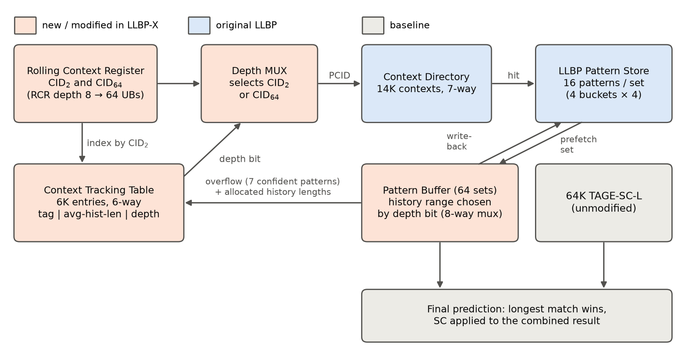
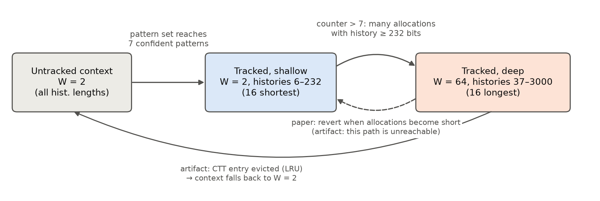
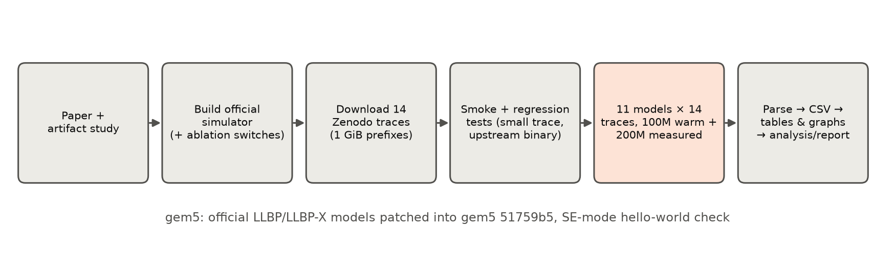

# 7. Proposed LLBP-X Architecture

## 7.1 Why LLBP loses accuracy

The authors perform a limit study on a 0-latency LLBP, removing one design constraint at a time (paper Fig. 5). Allowing an *unlimited number of patterns per set* yields the largest gain (9.1 %). Removing *contextualization* yields 4.3 %. Removing the practical design tweaks (4.6 %), widening tags (1.3 %) and allowing unlimited contexts (3.9 %) matter less. Two observations explain this (paper Figs. 6–9, NodeApp):

1. **Skewed utilisation:** only 14 % of contexts need more than 16 useful patterns, while 68 % need 8 or fewer. The over-subscribed contexts are those whose patterns have long histories, i.e. contexts containing hard-to-predict (H2P) branches.
2. **Duplication:** short-history patterns are replicated across many contexts. At history length 6, 8.5 % / 10.1 % / 17.2 % of useful patterns are duplicates for W = 2 / 8 / 64. A shallow context depth (W = 2) increases useful predictions from short histories by 63–213 %. A deep one (W = 64) increases useful predictions from long histories by 4.2–95 %.

No single W is best for all contexts. This is the key insight behind LLBP-X.

## 7.2 Architecture overview

Figure 1 shows the LLBP-X organisation. The LLBP structures (context directory, pattern store, pattern buffer) are retained. The RCR, the context-ID selection, the pattern-buffer history multiplexer and a new Context Tracking Table (CTT) are modified or added.

*Figure 1. LLBP-X organisation (schematic redrawn from paper Fig. 10 and the artifact code). Orange: new or modified in LLBP-X; blue: original LLBP; grey: baseline TAGE-SC-L.*

Storage parameters (paper §VI and `artifact/bpmodels/llbpx/llbpx.h`):

| Structure | LLBP | LLBP-X |
|---|---|---|
| Base predictor | 64K TAGE-SC-L | 64K TAGE-SC-L |
| Contexts (CD) | 14K, 7-way, 2-bit replacement | 14K, 7-way, 3-bit replacement |
| Pattern set | 16 patterns, 4 buckets × 4, 13-bit tag | same |
| Pattern buffer | 64 entries, 4-way | same |
| Context depth W | 8 (fixed) | 2 or 64 per context |
| Prefetch distance D | 4 | 4 |
| History lengths | fixed 16 of 21 | 16 of 21 selected by depth |
| CTT | – | 6K entries, 6-way (9 KB) |
| Total storage | ≈ 515 KB | ≈ 515 KB + 9.36 KB (+1.8 %) |

# 8. Detailed Explanation of the Two Optimisations

## 8.1 Dynamic context depth adaptation

Every context starts *shallow* (W = 2), which minimises duplication and training time. A context becomes *deep* (W = 64), spreading its patterns over many pattern sets, only when there is evidence that it is under capacity pressure and that its patterns need long histories:

1. **Overflow detection.** When a pattern set in the PB holds Tmax = 7 confident patterns, the PB signals the CTT, which starts tracking the context. The CTT is indexed by the shallow context ID CID₂, regardless of the depth in use.
2. **History-length evidence.** For a tracked context, a 3-bit saturating counter (avg-hist-len) is incremented for every allocation whose history length is at least Hth = 232 bits and decremented otherwise. On saturation the depth bit flips to W = 64. According to the paper, the same rule with hysteresis switches a deep context back to W = 2 when allocations become short. **Code finding:** in the artifact, the switching block in `llbpAllocate` is guarded by `ci->wi < nW-1` (i.e. it only executes while the context is shallow), so the deep→shallow branch inside it is unreachable. A deep context returns to W = 2 only when its CTT entry is evicted by LRU replacement, after which the context is untracked and defaults to W = 2. We did not change this behaviour; our results therefore reflect the artifact as published.
3. **Context-ID selection.** The RCR computes CID₂ and CID₆₄ in parallel on every unconditional branch. The depth bit read from the CTT selects which ID is used for prefetching (PCID) and for indexing the pattern buffer (CCID). All of this happens off the prediction critical path.

*Figure 2. Per-context depth states (`llbpAllocate`, `llbpUpdate`). The counter is `allocVsDrop`; the threshold is TAGE table index 22, which is 232 bits. The dashed deep→shallow transition described in the paper is unreachable in the artifact code; deep contexts fall back to W = 2 only on CTT eviction.*

Only two depths are used. Each switch discards the patterns learned at the previous depth, and the authors found that this retraining penalty offsets any benefit of finer granularity. In the artifact, `WS = {2, 64}`, `adaptThreshold = 7`, `histLenThreshold = 22` (a TAGE table index) and `CitSize = 6144`, `CitAssoc = 6`.

## 8.2 Dynamic history range selection

LLBP stores only 16 of TAGE's 21 history lengths. LLBP-X exploits the correlation between depth and history length. Shallow contexts use the **16 shortest** lengths (6–232 bits) and deep contexts use the **16 longest** (37–3000 bits), so all 21 lengths are covered while each pattern set still uses 16 slots in 4 buckets. An allocation outside the active range is dropped but still updates the avg-hist-len counter. In hardware, the depth bit drives an 8-way (instead of 4-way) history-length multiplexer in the PB.

## 8.3 Mathematical summary

Let *h(a)* be the history length of allocation *a* in context *c*, and *nc* the depth-switch counter (`allocVsDrop` in the code):

$$ n_c \leftarrow n_c + 1 \quad \text{if } (W_c = 2 \;\text{and}\; h(a) \geq H_{th}) \;\text{or}\; (W_c = 64 \;\text{and}\; h(a) < H_{th}) $$

$$ n_c \leftarrow \max(n_c - 1,\, 0) \quad \text{otherwise} $$

and the depth switches from *Wc* = 2 to 64 when *nc* > 7, after which *nc* is reset to 0. The counter counts *evidence for the other depth*. In the artifact, only the 2 → 64 transition is reachable (see the code finding above).

# 9. Experimental Methodology

*Figure 3. Project methodology.*

1. **Artifact study.** Every paper concept was mapped to code (`IMPLEMENTATION.md`).
2. **Build.** The official CBP-style simulator was built with CMake (Release, `-O3`).
3. **Ablation extension.** Two runtime switches were added to LLBP-X, defaulting to the upstream behaviour.
4. **Validation.** A smoke test ran on the official small test trace. A regression test compared our binary against a pristine build of upstream commit `68e1cae`: outputs were identical for all six upstream models (`logs/validation.md`).
5. **Traces.** The 14 official traces were downloaded from Zenodo. Because of very slow transfer rates, we downloaded the first 1 GiB of each (whole file if smaller), which is enough for the 300 M instructions simulated. Every run was checked for the simulator's "Reached end of trace" message.
6. **Experiments.** 11 predictor configurations × 14 traces = 154 simulations, with 100 M warm-up and 200 M measured instructions and `--simulate-btb`, exactly as in the official `scripts/eval_all.sh`.
7. **Processing.** Raw logs were parsed into one CSV, with internal consistency assertions (MPKI and accuracy recomputed from counts). All tables and graphs are generated from that CSV only.

The predictor configurations are listed in Table 1.

*Table 1. Evaluated predictor configurations (all on the same 64K TSL base where applicable).*

| ID (CLI) | Label | Role |
|---|---|---|
| `tage64kscl` | 64K TSL | Primary baseline |
| `tage512kscl` | 512K TSL | Ideal 0-latency upper bound with similar storage |
| `llbp-timing` | LLBP | Original LLBP, pattern-store latency modelled (paper Fig. 12 "LLBP") |
| `llbpx-timing` | LLBP-X | Proposed design, latency modelled (paper Fig. 12 "LLBP-X") |
| `llbpx-optw` | LLBP-X Opt-W | Oracle W per context (official offline tables), latency modelled |
| `llbp`, `llbpx` | LLBP-0Lat, LLBP-X-0Lat | Without prefetch latency |
| `llbpx-timing-nodepth` | LLBP-X no-depth | Ablation: depth adaptation off (range selection only) |
| `llbpx-timing-norange` | LLBP-X no-range | Ablation: range selection off (depth adaptation only) |
| `llbpx-nodepth`, `llbpx-norange` | 0-latency ablations | Same, without prefetch latency |

# 10. Simulator and Implementation Details

The simulator (`artifact/main.cc`) reads ChampSim-format traces (64-byte records with PC, branch flag, taken flag and register operands) through a `gzip -dc` pipe. It classifies branches (conditional, direct/indirect jump, call, return) and calls the predictor's `GetPrediction` / `UpdatePredictor` for conditional branches and `TrackOtherInst` for others. With `--simulate-btb`, a 16K-entry, 8-way BTB is modelled, and branches never seen taken are not used to update the predictor, mimicking a BTB-filtered commercial predictor. After the warm-up count is reached, statistics are snapshotted and the region of interest (ROI) is measured. MPKI is computed over ROI instructions. The timing variants (`-timing`) advance a tick per branch and only allow LLBP to provide a prediction if the pattern set has arrived in the PB, which models the prefetch latency (`accessDelay` = 5 for LLBP and 4 for LLBP-X in the artifact). The simulator does not model a pipeline, so it reports no IPC.

Implementation details of the three predictors and our modifications are given in `IMPLEMENTATION.md`. In summary: all predictor models are the authors' own and were reused unchanged. We added a 7-line accuracy printout to `main.cc`, and runtime ablation switches (`depthAdaptation`, `histRangeSel`) with four ablation model names to LLBP-X. The default configuration is unchanged.

# 11. Benchmark and Workload Description

*Table 2. Official server traces (ChampSim format, user + kernel instructions). Sizes from Zenodo record 13133243.*

| Workload | Trace | Suite / origin | Trace size | Bytes used |
|---|---|---|---|---|
TRACE_TABLE_ROWS

Ten traces were collected by the authors running the server applications under gem5 full-system simulation (Ubuntu 20.04, Linux 5.4.84). The four Google traces were converted from the DynamoRIO Google Workload Traces [12].

# 12. Evaluation Metrics

* **Branch MPKI** (primary, as in the paper): conditional-branch mispredictions per 1000 instructions in the ROI.
$$\text{MPKI} = 1000 \cdot \frac{\text{ROI mispredictions}}{\text{ROI instructions}}$$
* **Prediction accuracy**: fraction of ROI conditional branches predicted correctly.
$$\text{Accuracy} = 1 - \frac{\text{ROI mispredictions}}{\text{ROI conditional branches}}$$
* **MPKI improvement / reduction** of a model over a baseline:
$$\text{Improvement}(\%) = \frac{\text{MPKI}_{\text{base}} - \text{MPKI}_{\text{model}}}{\text{MPKI}_{\text{base}}} \times 100$$
* **Aggregates.** "Mean" is the improvement of the arithmetic-mean MPKI over workloads; this is what the official notebook plots. "AvgRed" is the arithmetic mean of per-workload improvements. Both are reported.
* **Contribution share** of the two optimisations, attributed incrementally (LLBP → depth adaptation only → full LLBP-X):
$$\text{share}_{\text{depth}} = \frac{\text{MPKI}_{\text{LLBP}} - \text{MPKI}_{\text{no-range}}}{\text{MPKI}_{\text{LLBP}} - \text{MPKI}_{\text{LLBP-X}}},\qquad \text{share}_{\text{range}} = 1 - \text{share}_{\text{depth}}$$
* **IPC** is *not* available from the trace-based simulator, and the gem5 full-system workloads are not part of the artifact (Section 16).
