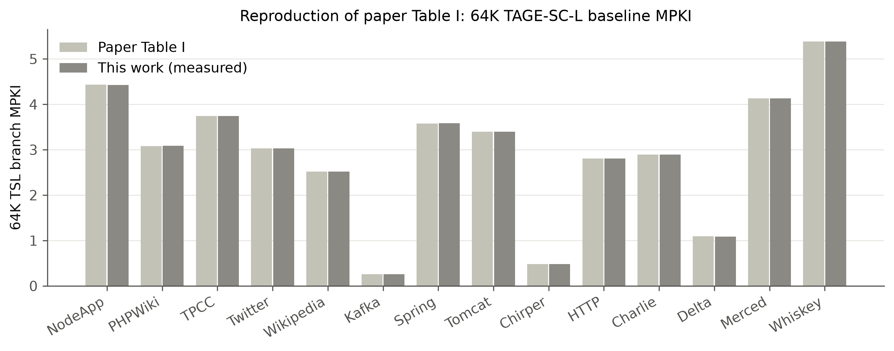
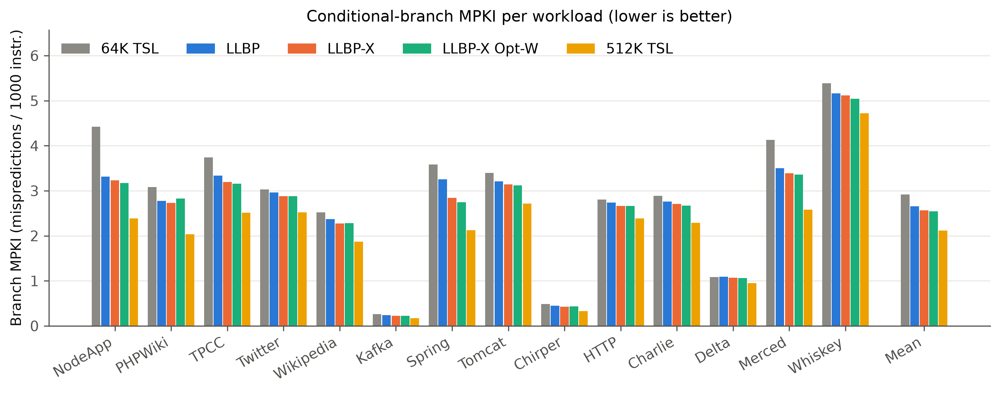
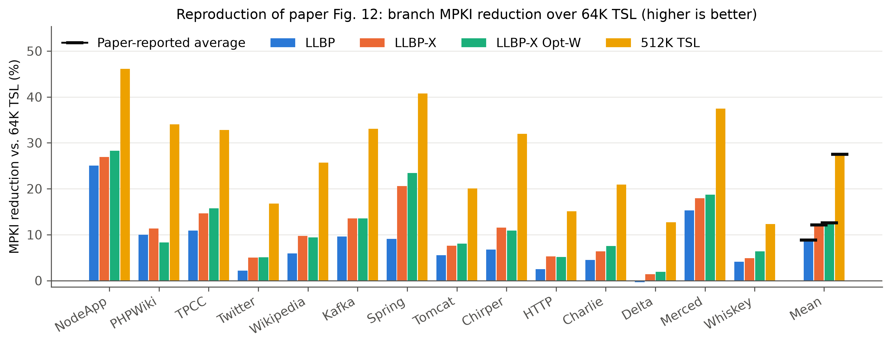
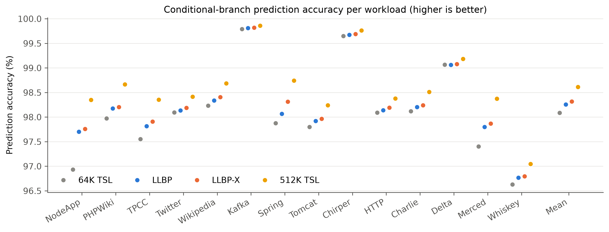
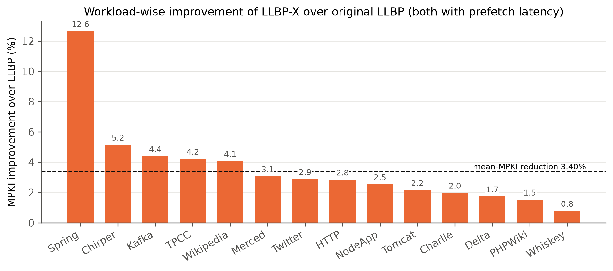
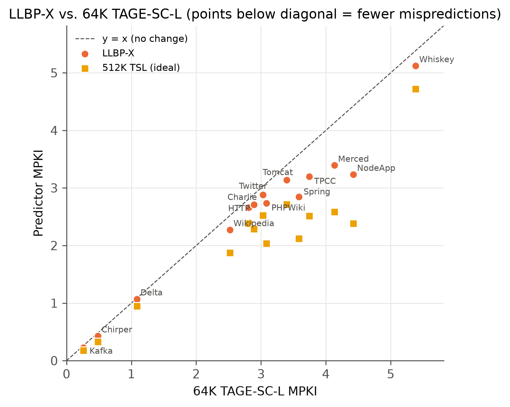
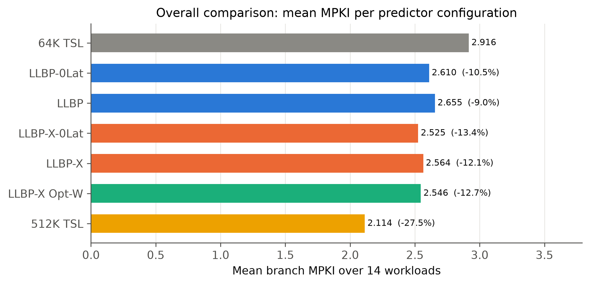
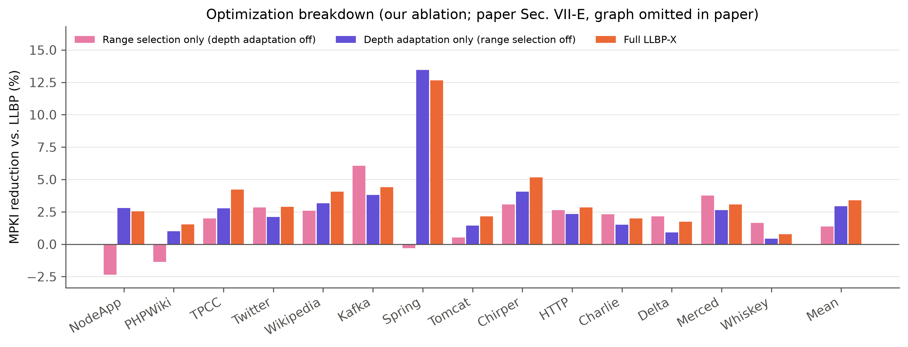
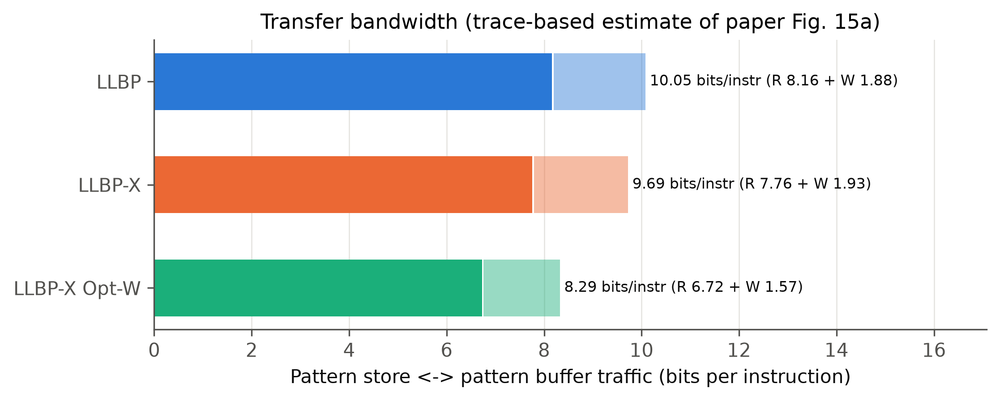
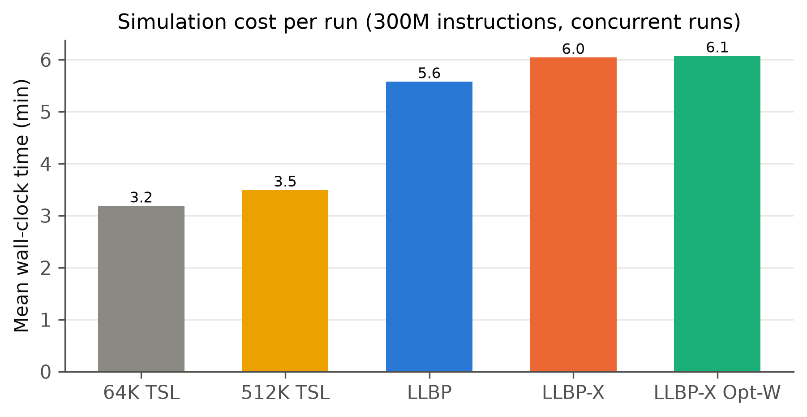

# 13. Experimental Results

All 154 simulations (11 configurations × 14 workloads) completed successfully with exit code 0. For 132 runs the measured region ran entirely on unrepeated trace data. The remaining 22 runs are those on Charlie and Whiskey: the complete official traces contain only about 270 M and 235 M instructions respectively, so the official simulator repeats them, exactly as it would for the paper's authors (Section 16). All values below are read from `results/processed/all_results.csv`.

## 13.1 Validation of the baseline: Table I

*Table 3. 64K TSL MPKI: paper Table I vs. this work.*

{{CSV:table1_reproduction_64k_tsl.csv:workload,paper_64k_tsl_mpki,measured_64k_tsl_mpki,abs_diff,rel_diff_pct:3}}

All 14 baseline values agree with the paper to within ±0.005 MPKI (at most 0.63 % relative, on Chirper, whose MPKI is very low), and the means are identical (2.916). The simulator, the traces and the warm-up/measurement windows are therefore the same as those behind the paper's accuracy results.



*Figure 4. 64K TSL MPKI per workload, paper Table I vs. this work.*

## 13.2 Absolute MPKI and accuracy

*Table 4. Conditional-branch MPKI (100 M warm-up + 200 M measured instructions). Lower is better. "Mean" is the arithmetic mean.*

{{CSV:table_mpki_all_predictors.csv:workload,64K TSL,LLBP,LLBP-X,LLBP-X Opt-W,512K TSL,LLBP-0Lat,LLBP-X-0Lat:3}}

*Table 5. Conditional-branch prediction accuracy (%). Higher is better.*

{{CSV:table_accuracy_all_predictors.csv:workload,64K TSL,LLBP,LLBP-X,LLBP-X Opt-W,512K TSL:3}}

## 13.3 MPKI reduction over 64K TSL: Fig. 12

*Table 6. MPKI reduction (%) relative to 64K TSL. Last rows: aggregate statistics.*

{{CSV:table_mpki_reduction_vs_64k_tsl.csv:workload,LLBP,LLBP-X,LLBP-X Opt-W,512K TSL,LLBP-0Lat,LLBP-X-0Lat:2}}

## 13.4 LLBP-X vs. original LLBP

*Table 7. MPKI improvement (%) of LLBP-X over LLBP.*

{{CSV:table_llbpx_vs_llbp.csv:workload,LLBP->LLBP-X,LLBP-0Lat->LLBP-X-0Lat,LLBP->LLBP-X Opt-W:2}}

## 13.5 Optimisation breakdown (ablation)

*Table 8. Ablation of the two optimisations, prefetch latency modelled (Mean row = arithmetic-mean MPKI). "depth only" = range selection disabled; "range only" = depth adaptation disabled.*

{{ABLATION}}

## 13.6 Pattern-store transfer bandwidth

*Table 9. Pattern-store ↔ pattern-buffer traffic in bits per instruction (288 bits per pattern-set read or dirty write-back).*

{{CSV:table_bandwidth_bits_per_instr.csv:workload,LLBP,LLBP-X,LLBP-X Opt-W:2}}

## 13.7 gem5 integration check

The official gem5 models were patched into gem5 (commit `51759b5`) and the ARM `gem5.opt` binary was built. The artifact's SE-mode hello-world test was run with each predictor on a detailed O3 core.

*Table 10. gem5 hello-world (SE mode, ARM, O3 CPU). Source: `results/gem5/<model>/stats.txt`.*

| gem5 model | Predictor configuration | Instructions | Cond. lookups | Mispredictions | IPC |
|---|---|---|---|---|---|
| TSL64k | TAGE-SC-L 64 KB | 5,208 | 2,003 | 58 | 0.1364 |
| LLBP | LLBP, depth adaptation off | 5,208 | 2,003 | 58 | 0.1364 |
| LLBPX | LLBP model with `adaptCtxDepth=true`, 6K-entry CTT | 5,208 | 2,003 | 58 | 0.1364 |

All three runs completed and printed "Hello world!". Each reported 58 mispredictions, against "around 56" in the artifact documentation. This confirms that the gem5 integration works. With only 5 K instructions, the program is far too short for the second-level predictor to matter, so these numbers say nothing about accuracy or speedup differences.

# 14. Graphical Comparison



*Figure 5. Absolute branch MPKI of 64K TSL, LLBP, LLBP-X, LLBP-X Opt-W and the ideal 512K TSL.*



*Figure 6. Reproduction of paper Fig. 12: MPKI reduction over 64K TSL. Black ticks on the Mean group mark the averages reported in the paper (8.8 %, 12.1 %, 12.6 %, 27.5 %); our values are 8.97 %, 12.06 %, 12.70 % and 27.52 %.*



*Figure 7. Conditional-branch prediction accuracy per workload (dot plot; the axis does not start at zero).*



*Figure 8. Per-workload MPKI improvement of LLBP-X over LLBP, sorted. No workload regresses.*



*Figure 9. LLBP-X and 512K TSL MPKI against the 64K TSL baseline. Points below the diagonal have fewer mispredictions than the baseline.*



*Figure 10. Mean MPKI per predictor configuration, with the reduction relative to 64K TSL.*



*Figure 11. Optimisation breakdown: MPKI reduction relative to LLBP for range selection only, depth adaptation only and full LLBP-X (latency modelled).*



*Figure 12. Mean pattern-store transfer bandwidth, split into reads and writes (trace-based estimate of paper Fig. 15a).*



*Figure 13. Mean simulation wall-clock time per 300 M-instruction run (concurrent runs on a 17-vCPU VM). This is a property of the simulator, not of the predictors.*

# 15. Performance Analysis

**Accuracy and MPKI.** Among realisable designs, LLBP-X has the lowest mean MPKI (2.564) and the highest accuracy (98.32 %). Only the oracle Opt-W variant (2.546) and the unrealisable 512K TSL (2.114) do better. LLBP-X reduces the mean MPKI of 64K TSL by **12.06 %**, against 8.97 % for LLBP, and it improves over both on all 14 workloads.

**Improvement over LLBP.** The per-workload improvement ranges from 0.78 % (Whiskey) to 12.65 % (Spring), with an average of **3.57 %** (paper: 0.8–11.5 %, average 3.6 %). The TSL-relative gain grows from 8.97 % to 12.06 %, i.e. by 34.5 % (paper: "36 % average improvement over the original design"). LLBP-X captures 43.8 % of the 64K→512K TSL opportunity, against 32.6 % for LLBP.

**Which workloads benefit.** Spring stands out: LLBP captures only 9 % of a 41 % opportunity there, and depth adaptation alone recovers 13.4 % on top of LLBP. Workloads with large capacity headroom (NodeApp, TPCC, Merced, Spring) see the largest absolute reductions. The Google traces Whiskey, Delta and Charlie, whose 512K-TSL headroom is small, gain least. The improvement over LLBP is moderately correlated with the 512K-TSL headroom (Pearson r = 0.50).

**Consistency.** The sign is consistent (14/14 with latency modelled); the magnitude is not (standard deviation 2.9 pp). Without Spring, the average improvement over LLBP drops from 3.57 % to 2.87 %. In the 0-latency configuration, LLBP-X is 2.2 % *worse* than LLBP on PHPWiki, so the benefit is not guaranteed in every configuration.

**Contribution of the two optimisations.** With incremental attribution (LLBP → depth adaptation → range selection) on mean MPKI, **dynamic context depth adaptation accounts for 86.4 %** of the LLBP→LLBP-X reduction and **history range selection for 13.6 %** (77 % / 23 % without latency). The paper reports 82 % / 18 %. Two observations refine this:

1. Depth adaptation is essential on H2P-heavy workloads. Without it, LLBP-X is worse than LLBP on NodeApp (−2.4 %), PHPWiki (−1.4 %) and Spring (−0.3 %).
2. On five workloads (Charlie, Delta, Kafka, Merced, Whiskey), the configuration *without* depth adaptation, i.e. every context shallow, beats full LLBP-X. For these programs the patterns lost on each W switch outweigh the capacity gained. This supports the paper's statement that switching cost limits the benefit of adaptation.

**Latency sensitivity.** Modelling the pattern-store latency costs LLBP 1.81 % and LLBP-X 1.67 % in MPKI on average, so LLBP-X's benefit holds up when latency is modelled.

**Bandwidth.** LLBP-X lowers the average transfer bandwidth from 10.05 to 9.69 bits/instruction (−3.6 %), with reads dominating (80 %). The paper's gem5 measurement is 10.6 → 9.9 (−6.1 %). The direction and magnitude agree, although our trace model has no wrong-path prefetches. LLBP-X uses *more* bandwidth than LLBP on Chirper, HTTP and Delta.

# 16. Discussion

**Fidelity of the reproduction.** The official artifact reproduces the paper's accuracy results almost exactly: Table I to within rounding, and the Fig. 12 averages to within 0.2 pp. The README warns that results "might slightly differ" because the paper used a ChampSim integration. Our evidence suggests that, at least for the averages and ranges reported in the text, the CBP-style simulator gives practically the same numbers. Two indications:

* The Charlie and Whiskey traces are shorter than the 300 M instructions simulated. The simulator therefore wraps around and the last 30–65 M ROI instructions are re-executions on a warm predictor. Our 64K TSL MPKI on these traces matches the paper to three digits, so the paper's numbers evidently include the same wrap-around. This is a methodological weakness of the official setup that the paper does not mention; it likely flatters the predictors slightly on those two traces.
* The few differences we see are at the extremes of the ranges: LLBP's minimum (Delta, −0.38 % vs 0.6 %) and LLBP-X's maximum gain over LLBP (Spring, 12.65 % vs 11.5 %).

**Trace prefixes.** Network constraints forced us to use the first 1–1.5 GiB of each trace rather than the complete file. Because the simulator reads traces sequentially and stops after 300 M instructions, this has no effect on results as long as the prefix contains 300 M instructions. Two prefixes initially did not (Kafka, NodeApp); this was detected by decompressing every prefix before use, and both were extended before simulation. No run on a prefix wrapped.

**Code vs paper.** The paper describes deep contexts reverting to the shallow depth when allocations become short. In the artifact, that branch is unreachable (Section 8.1), so a deep context only reverts when its CTT entry is evicted. Since our results match the paper, the paper's numbers were most likely produced with this behaviour. Making the reversion reachable is a natural experiment for future work.

**Ablation methodology.** Our ablation switches change one mechanism at a time inside the official model, and their default setting reproduces upstream output bit for bit. The shares depend on the attribution order (range-first would give range selection 40 %). We therefore regard the 82 %/18 % claim as consistent with, but not uniquely confirmed by, our data.

# 17. Limitations

1. **No IPC.** The trace-based simulator does not model a pipeline. The paper's speedup results (Fig. 13), prefetch timeliness, false-path and overriding studies (Fig. 14) require its gem5 full-system setup, which is not part of the artifact. GEM5_REPORT_SENTENCE
2. **Energy (Fig. 15b)** requires CACTI models that are not included.
3. **Limit-study and characterisation figures (Figs. 1, 5–9)** require hardware counters on Intel servers or unconstrained model variants not exposed in the artifact.
4. **Sensitivity studies (§VII-F/G, Fig. 16)** were not run, for lack of time; the parameters exist in `LLBPXConfig`.
5. **Trace prefixes** were used for 11 of 14 traces. They contain all instructions simulated, but our trace files are not byte-identical to the complete Zenodo files (SHA-256 of the bytes used: `logs/trace_manifest.csv`).
6. **Short Google traces** (Charlie, Whiskey) are repeated by the official simulator within the measured region; we kept this behaviour for comparability with the paper and labelled those runs.
7. **Single run per configuration.** The simulator is deterministic, so there is no run-to-run variance; however, results are for one 200 M-instruction region per workload.
8. **Same 14 workloads used for tuning and evaluation** in the original work; we could not evaluate on independent workloads.

# 18. Conclusion

We reproduced the trace-based evaluation of LLBP-X with the authors' official artifact on all 14 server traces and the paper's methodology. The baseline is reproduced exactly (Table I within ±0.005 MPKI), and the headline result is confirmed. LLBP-X reduces branch MPKI over a 64 KB TAGE-SC-L by **12.06 %** on average (paper: 12.1 %), against 8.97 % for the original LLBP, and improves over LLBP on every workload by 0.78–12.65 % (average **3.57 %**; paper: 3.6 %). An ablation we added to the official model shows that **dynamic context depth adaptation provides most of the gain (≈ 86 %)** and history range selection the rest (≈ 14 %), consistent with the paper's 82 %/18 %. It also shows that adaptation hurts on workloads with flat branch working sets, where an all-shallow configuration would be better. Even so, LLBP-X recovers only 44 % of the improvement of an ideal, equally sized 512 KB TAGE-SC-L. Closing that gap remains open.

# 19. Future Scope

* **Make the deep→shallow reversion reachable** and measure its effect; tune the hysteresis.
* **Workload-adaptive enabling** of depth adaptation, since an all-shallow configuration wins on five workloads.
* **Sensitivity studies** (H<sub>th</sub>, T<sub>max</sub>, CTT size, pattern-store size, smaller base TAGE) using the existing `LLBPXConfig` parameters.
* **Full-length evaluation** with complete traces and multiple simulation regions (SimPoints) per workload, avoiding wrap-around on short traces.
* **Timing evaluation in gem5** with full-system server workloads to measure IPC, prefetch timeliness and energy.
* **More than two depths, or soft migration** of patterns between depths, to reduce the switching cost.

# References

[1] D. Schall, M. Ďuračková, B. Grot, "The Last-Level Branch Predictor Revisited," in *Proc. 32nd IEEE Int. Symp. on High-Performance Computer Architecture (HPCA)*, 2026. Artifact: <https://github.com/dhschall/LLBP-X>, DOI 10.5281/zenodo.17807918.

[2] D. Schall, A. Sandberg, B. Grot, "The Last-Level Branch Predictor," in *Proc. 57th IEEE/ACM Int. Symp. on Microarchitecture (MICRO)*, 2024.

[3] A. Seznec, P. Michaud, "A case for (partially) TAgged GEometric history length branch prediction," *J. Instruction-Level Parallelism*, vol. 8, 2006.

[4] A. Seznec, "TAGE-SC-L branch predictors again," in *5th JILP Workshop on Computer Architecture Competitions (CBP-5)*, 2016.

[5] D. A. Jiménez, "Reconsidering complex branch predictors," in *Proc. HPCA*, 2003.

[6] A. Seznec, S. Felix, V. Krishnan, Y. Sazeides, "Design tradeoffs for the Alpha EV8 conditional branch predictor," in *Proc. ISCA*, 2002.

[7] A. Seznec, A. Fraboulet, "Effective ahead pipelining of instruction block address generation," in *Proc. ISCA*, 2003.

[8] L. Cai, A. Deshmukh, Y. Patt, "Enabling ahead prediction with practical energy constraints," in *Proc. ISCA*, 2025.

[9] T. A. Khan et al., "Whisper: Profile-guided branch misprediction elimination for data center applications," in *Proc. MICRO*, 2022.

[10] S. Zangeneh, S. Pruett, S. Lym, Y. N. Patt, "BranchNet: A convolutional neural network to predict hard-to-predict branches," in *Proc. MICRO*, 2020.

[11] S. Pruett, Y. N. Patt, "Branch runahead: An alternative to branch prediction for impossible to predict branches," in *Proc. MICRO*, 2021.

[12] DynamoRIO, "Google workload traces," 2024. <https://dynamorio.org/google_workload_traces.html>

[13] D. Schall, "Server traces for the Last-Level Branch Predictor," Zenodo, DOI 10.5281/zenodo.13133242.

[14] J. Lowe-Power et al., "The gem5 simulator: Version 20.0+," arXiv:2007.03152, 2020.

# Appendix A. Reproducing this report

```bash
scripts/run_experiments.sh -j 12          # 154 simulations
.venv/bin/python scripts/parse_results.py
.venv/bin/python scripts/make_figures.py
.venv/bin/python scripts/make_diagrams.py
.venv/bin/python scripts/assemble_report.py   # builds this Markdown file from REPORT/part*.md + tables
.venv/bin/python scripts/build_report_pdf.py
```

# Appendix B. Contribution statement

| Item | Original authors | This project |
|---|---|---|
| LLBP / LLBP-X / TAGE-SC-L models, simulator, gem5 models, Opt-W tables | ✔ | reused unchanged |
| ROI accuracy output, ablation switches (90 lines, `src/patches/`) | | ✔ |
| Experiment driver, parser, figures, PDF, trace downloader, validation | | ✔ |
| All experiments, analysis and documentation | | ✔ |
