<div class="titlepage" markdown="1">

<h1 class="title">Reproducing and Analysing LLBP-X: <br/>The Last-Level Branch Predictor Revisited</h1>

**University Research Project in Computer Architecture**

Project report

Based on: D. Schall, M. Ďuračková and B. Grot, "The Last-Level Branch Predictor Revisited," *HPCA-32*, 2026

Official artifact: <https://github.com/dhschall/LLBP-X> (commit `68e1cae`)

Report date: 16 November 2026

</div>

# Abstract

Branch mispredictions are a dominant source of lost cycles on modern server workloads, whose branch working sets far exceed the capacity of latency-constrained predictors such as the 64 KB TAGE-SC-L. The Last-Level Branch Predictor (LLBP) backs TAGE-SC-L with a large, decoupled pattern store and prefetches the patterns needed for upcoming *program contexts*. LLBP-X, proposed at HPCA 2026, revisits LLBP. It identifies contention in pattern sets of hard-to-predict branches and duplication of short-history patterns as LLBP's main inefficiencies, and introduces *dynamic context depth adaptation* together with *dynamic history range selection*.

This project reproduces the trace-based evaluation of LLBP-X using the authors' official artifact. We compare TAGE-SC-L (64 KB and an idealised 512 KB), the original LLBP and LLBP-X, including the oracle "Opt-W" variant, on all 14 official server traces. We use the paper's methodology of 100 M warm-up and 200 M measured instructions. To quantify the contribution of each optimisation, which the paper reports without a graph, we add two runtime ablation switches to the official LLBP-X model and verify that its default behaviour is bit-identical to upstream.

Our 64K TSL baseline matches the paper's Table I to within ±0.005 MPKI on every workload. LLBP-X reduces mean branch MPKI over 64K TSL by 12.06 % (paper: 12.1 %), compared with 8.97 % for LLBP and 27.52 % for the ideal 512K TSL. It improves on LLBP on all 14 workloads by 0.78–12.65 % (average 3.57 %; paper: 0.8–11.5 %, average 3.6 %). Our ablation attributes 86 % of the gain to dynamic context depth adaptation and 14 % to history range selection (paper: 82 %/18 %). A trace-based estimate shows LLBP-X also lowers pattern-store traffic. We further identify a discrepancy between the paper and the artifact code (deep contexts never revert to the shallow depth except on CTT eviction), and that the two shortest official traces are repeated by the simulator within the measured region.

All code, raw outputs, processed data, figures and scripts needed to regenerate every number in this report are included in the project repository.

# 1. Introduction

High-performance cores rely on the branch predictor to keep a deep and wide pipeline supplied with useful instructions. Every misprediction flushes the in-flight wrong-path work, typically tens of cycles and hundreds of instructions. The problem is acute for server software. Instruction footprints keep growing (Meta reports a 5.6× binary growth of a major service in four years), and Google measured that mispredictions waste 15.4 % of datacenter CPU cycles [1]. At the same time, the predictor sits on the critical fetch path, so its capacity cannot simply be increased without increasing latency [1].

LLBP [2] broke this capacity-latency trade-off with a two-level organisation. An unmodified TAGE-SC-L serves predictions at full speed. A high-capacity second level stores additional TAGE patterns grouped by *program context*, and the patterns of upcoming contexts are prefetched into a small pattern buffer. LLBP nevertheless recovers less than one third of the accuracy improvement of an equally sized (but unrealisable) 512 KB TAGE-SC-L. LLBP-X [1] analyses why and proposes a remedy that costs only about 9.4 KB of extra storage.

This report documents a complete reproduction study of LLBP-X:

* a technical analysis of the paper and its official artifact (Sections 2–6);
* the setup and integration of the official simulator and the three predictors, plus a small, verified extension that enables an ablation study (Sections 7–8);
* an evaluation on all 14 official server traces with the paper's warm-up and measurement windows (Sections 9–11);
* an analysis of the results and of what can and cannot be reproduced with the artifact (Sections 12–14).

**Contribution split.** The predictor models, the simulator, the gem5 models and the Opt-W tables are the work of the original authors. Our contributions are the experimental campaign and its infrastructure (driver, parser, plotting, PDF generation, robust trace downloader), the accuracy output and ablation switches in the simulator (90 added lines, documented in `src/patches/`), the regression validation, and all analysis and documentation.

# 2. Background and Related Work

## 2.1 TAGE and TAGE-SC-L

TAGE [3, 4] predicts with a bimodal base table plus several partially tagged tables indexed by hashes of the branch PC and global histories of geometrically increasing length. The longest matching table provides the prediction, and on a misprediction a new entry with a longer history is allocated. TAGE-SC-L [4] adds a statistical corrector (SC) for statistically biased branches and a loop predictor. The 64 KB TAGE-SC-L used as the baseline in both LLBP papers uses 21 tagged tables with histories from 6 to 3000 bits.

## 2.2 Larger and faster predictors

Making TAGE-SC-L 8× larger (512 KB) reduces mispredictions on the paper's workloads by 27.5 % on average. However, the prediction latency then grows beyond what a single-cycle or short overriding pipeline can tolerate [1, 5]. Prior approaches to hiding latency include overriding predictors [6], ahead pipelining [7, 8] and prefetching prediction counters into a small structure [5]. Whisper [9] and machine-learning predictors [10] target hard-to-predict branches with profiling and ISA support. Runahead-style pre-computation [11] targets data-dependent branches. LLBP and LLBP-X are purely microarchitectural and need neither profiling nor ISA changes.

## 2.3 The Last-Level Branch Predictor

LLBP [2] observes that the patterns needed to predict a branch depend on the global control-flow path leading to it (*context locality*). It hashes the last W unconditional branches, skipping the most recent D, into a context ID, and stores all patterns learned in that context in a 16-entry pattern set. Pattern sets live in a large pattern store indexed through a context directory. Because the context ID skips D branches, the pattern set for the next context is known early and can be prefetched into a 64-entry pattern buffer (PB) before it is needed. The PB is looked up in parallel with TAGE, and LLBP overrides TAGE when its matching pattern has an equal or longer history.

# 3. Problem Statement

Given a fixed storage budget of about 0.5 MB for branch-prediction metadata, LLBP reduces 64K TSL mispredictions by only 8.8 % on average, whereas an ideal 512K TSL reaches 27.5 % [1]. The problem addressed by LLBP-X is to **find the causes of this efficiency gap and reduce it without putting new structures on the prediction critical path**.

For this project, the problem statement is: *Using the official artifact, independently evaluate whether LLBP-X delivers the claimed accuracy improvements over TAGE-SC-L and LLBP on the official server traces, quantify the contribution of its two optimisations, and identify which claims can and cannot be reproduced with the available artifact.*

# 4. Motivation

* **Stalls from mispredictions grow with core aggressiveness.** The paper's hardware measurements show Sapphire Rapids has 15–60 % fewer mispredictions than Skylake, yet the fraction of stall cycles due to mispredictions increases by 7–45 %, because a larger instruction window hides other stalls but not flushes [1].
* **Capacity matters for servers.** The gap between 64K and 512K TSL (27.5 %) shows that much of the misprediction rate is a capacity problem.
* **LLBP leaves most of the opportunity unused.** A hierarchical design that matched the 512K TSL would be a practical way to buy a large accuracy gain.
* **Reproducibility.** The authors' README warns that artifact results "might slightly differ" from the paper, which used a ChampSim integration. An independent reproduction tells future users what to expect from the artifact.

# 5. Research Objectives

1. Understand the LLBP and LLBP-X designs and map every paper concept to the artifact code.
2. Build the official simulator and evaluate 64K TSL, 512K TSL, LLBP, LLBP-X and LLBP-X Opt-W under identical conditions on all 14 official traces.
3. Reproduce Table I (baseline MPKI) and Fig. 12 (MPKI reduction over 64K TSL) of the paper.
4. Quantify the separate contributions of dynamic context depth adaptation and dynamic history range selection (paper §VII-E).
5. Analyse accuracy, MPKI, per-workload behaviour, consistency and trade-offs, and classify each paper result as reproduced, partially reproduced or not reproducible.
6. Package everything as a clean, reproducible repository with documentation and this report.

# 6. Existing Branch Prediction Techniques

| Technique | Idea | Strength | Limitation for server workloads |
|---|---|---|---|
| Bimodal / gshare | PC-indexed or PC⊕history-indexed counters | Simple, single-cycle | Aliasing; no long-history correlation |
| Perceptron / neural predictors | Weighted sum of history bits | Long histories | Latency and energy; still capacity-bound |
| TAGE / TAGE-SC-L [3, 4] | Partial matching over geometric histories | State of the art, used commercially | 64 KB capacity too small for server branch working sets |
| Overriding / ahead pipelining [6–8] | Fast predictor overridden by slow one, or early prediction | Hides latency | Redirect penalties; whole predictor accessed every cycle |
| Profile-guided (Whisper) [9], CNN predictors [10] | Offline profiling of hard-to-predict branches | Large gains on targeted branches | Needs profiles, ISA and OS support |
| LLBP [2] | Context-organised second-level store with prefetch | Large capacity without latency | Pattern-set contention and duplication (§7) |
| **LLBP-X** [1] | LLBP + per-context adaptive context depth and history range | Better use of the same capacity | Still far from ideal 512K TSL; extra CTT energy |


# 7. Proposed LLBP-X Architecture

## 7.1 Why LLBP loses accuracy

The authors perform a limit study on a 0-latency LLBP, removing one design constraint at a time (paper Fig. 5). Allowing an *unlimited number of patterns per set* yields the largest gain (9.1 %). Removing *contextualization* yields 4.3 %. Removing the practical design tweaks (4.6 %), widening tags (1.3 %) and allowing unlimited contexts (3.9 %) matter less. Two observations explain this (paper Figs. 6–9, NodeApp):

1. **Skewed utilisation:** only 14 % of contexts need more than 16 useful patterns, while 68 % need 8 or fewer. The over-subscribed contexts are those whose patterns have long histories, i.e. contexts containing hard-to-predict (H2P) branches.
2. **Duplication:** short-history patterns are replicated across many contexts. At history length 6, 8.5 % / 10.1 % / 17.2 % of useful patterns are duplicates for W = 2 / 8 / 64. A shallow context depth (W = 2) increases useful predictions from short histories by 63–213 %. A deep one (W = 64) increases useful predictions from long histories by 4.2–95 %.

No single W is best for all contexts. This is the key insight behind LLBP-X.

## 7.2 Architecture overview

Figure 1 shows the LLBP-X organisation. The LLBP structures (context directory, pattern store, pattern buffer) are retained. The RCR, the context-ID selection, the pattern-buffer history multiplexer and a new Context Tracking Table (CTT) are modified or added.

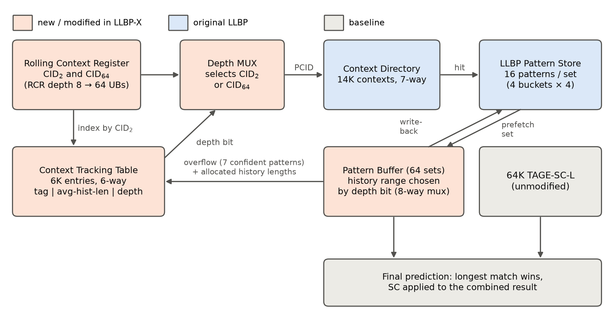

*Figure 1. LLBP-X organisation (schematic redrawn from paper Fig. 10 and the artifact code). Orange: new or modified in LLBP-X; blue: original LLBP; grey: baseline TAGE-SC-L.*

Storage parameters (paper §VI and `artifact/bpmodels/llbpx/llbpx.h`):

| Structure | LLBP | LLBP-X |
|---|---|---|
| Base predictor | 64K TAGE-SC-L | 64K TAGE-SC-L |
| Contexts (CD) | 14K, 7-way, 2-bit replacement | 14K, 7-way, 3-bit replacement |
| Pattern set | 16 patterns, 4 buckets × 4, 13-bit tag | same |
| Pattern buffer | 64 entries, 4-way | same |
| Context depth W | 8 (fixed) | 2 or 64 per context |
| Prefetch distance D | 4 | 4 |
| History lengths | fixed 16 of 21 | 16 of 21 selected by depth |
| CTT | – | 6K entries, 6-way (9 KB) |
| Total storage | ≈ 515 KB | ≈ 515 KB + 9.36 KB (+1.8 %) |

# 8. Detailed Explanation of the Two Optimisations

## 8.1 Dynamic context depth adaptation

Every context starts *shallow* (W = 2), which minimises duplication and training time. A context becomes *deep* (W = 64), spreading its patterns over many pattern sets, only when there is evidence that it is under capacity pressure and that its patterns need long histories:

1. **Overflow detection.** When a pattern set in the PB holds T<sub>max</sub> = 7 confident patterns, the PB signals the CTT, which starts tracking the context. The CTT is indexed by the shallow context ID CID₂, regardless of the depth in use.
2. **History-length evidence.** For a tracked context, a 3-bit saturating counter (avg-hist-len) is incremented for every allocation whose history length is at least H<sub>th</sub> = 232 bits and decremented otherwise. On saturation the depth bit flips to W = 64. According to the paper, the same rule with hysteresis switches a deep context back to W = 2 when allocations become short. **Code finding:** in the artifact, the switching block in `llbpAllocate` is guarded by `ci->wi < nW-1` (i.e. it only executes while the context is shallow), so the deep→shallow branch inside it is unreachable. A deep context returns to W = 2 only when its CTT entry is evicted by LRU replacement, after which the context is untracked and defaults to W = 2. We did not change this behaviour; our results therefore reflect the artifact as published.
3. **Context-ID selection.** The RCR computes CID₂ and CID₆₄ in parallel on every unconditional branch. The depth bit read from the CTT selects which ID is used for prefetching (PCID) and for indexing the pattern buffer (CCID). All of this happens off the prediction critical path.

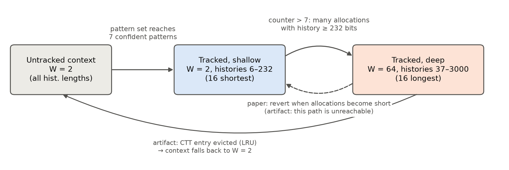

*Figure 2. Per-context depth states (`llbpAllocate`, `llbpUpdate`). The counter is `allocVsDrop`; the threshold is TAGE table index 22, which is 232 bits. The dashed deep→shallow transition described in the paper is unreachable in the artifact code; deep contexts fall back to W = 2 only on CTT eviction.*

Only two depths are used. Each switch discards the patterns learned at the previous depth, and the authors found that this retraining penalty offsets any benefit of finer granularity. In the artifact, `WS = {2, 64}`, `adaptThreshold = 7`, `histLenThreshold = 22` (a TAGE table index) and `CitSize = 6144`, `CitAssoc = 6`.

## 8.2 Dynamic history range selection

LLBP stores only 16 of TAGE's 21 history lengths. LLBP-X exploits the correlation between depth and history length. Shallow contexts use the **16 shortest** lengths (6–232 bits) and deep contexts use the **16 longest** (37–3000 bits), so all 21 lengths are covered while each pattern set still uses 16 slots in 4 buckets. An allocation outside the active range is dropped but still updates the avg-hist-len counter. In hardware, the depth bit drives an 8-way (instead of 4-way) history-length multiplexer in the PB.

## 8.3 Mathematical summary

Let *h(a)* be the history length of allocation *a* in context *c*, and *n<sub>c</sub>* the depth-switch counter (`allocVsDrop` in the code):

$$ n_c \leftarrow n_c + 1 \quad \text{if } (W_c = 2 \;\text{and}\; h(a) \geq H_{th}) \;\text{or}\; (W_c = 64 \;\text{and}\; h(a) < H_{th}) $$

$$ n_c \leftarrow \max(n_c - 1,\, 0) \quad \text{otherwise} $$

and the depth switches from *W<sub>c</sub>* = 2 to 64 when *n<sub>c</sub>* > 7, after which *n<sub>c</sub>* is reset to 0. The counter counts *evidence for the other depth*. In the artifact, only the 2 → 64 transition is reachable (see the code finding above).

# 9. Experimental Methodology

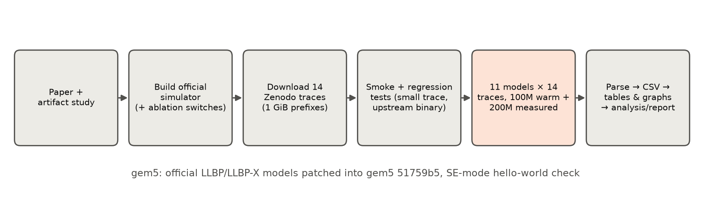

*Figure 3. Project methodology.*

1. **Artifact study.** Every paper concept was mapped to code (`IMPLEMENTATION.md`).
2. **Build.** The official CBP-style simulator was built with CMake (Release, `-O3`).
3. **Ablation extension.** Two runtime switches were added to LLBP-X, defaulting to the upstream behaviour.
4. **Validation.** A smoke test ran on the official small test trace. A regression test compared our binary against a pristine build of upstream commit `68e1cae`: outputs were identical for all six upstream models (`logs/validation.md`).
5. **Traces.** The 14 official traces were downloaded from Zenodo. Because of very slow transfer rates, we downloaded the first 1 GiB of each (whole file if smaller), which is enough for the 300 M instructions simulated. Every run was checked for the simulator's "Reached end of trace" message.
6. **Experiments.** 11 predictor configurations × 14 traces = 154 simulations, with 100 M warm-up and 200 M measured instructions and `--simulate-btb`, exactly as in the official `scripts/eval_all.sh`.
7. **Processing.** Raw logs were parsed into one CSV, with internal consistency assertions (MPKI and accuracy recomputed from counts). All tables and graphs are generated from that CSV only.

The predictor configurations are listed in Table 1.

*Table 1. Evaluated predictor configurations (all on the same 64K TSL base where applicable).*

| ID (CLI) | Label | Role |
|---|---|---|
| `tage64kscl` | 64K TSL | Primary baseline |
| `tage512kscl` | 512K TSL | Ideal 0-latency upper bound with similar storage |
| `llbp-timing` | LLBP | Original LLBP, pattern-store latency modelled (paper Fig. 12 "LLBP") |
| `llbpx-timing` | LLBP-X | Proposed design, latency modelled (paper Fig. 12 "LLBP-X") |
| `llbpx-optw` | LLBP-X Opt-W | Oracle W per context (official offline tables), latency modelled |
| `llbp`, `llbpx` | LLBP-0Lat, LLBP-X-0Lat | Without prefetch latency |
| `llbpx-timing-nodepth` | LLBP-X no-depth | Ablation: depth adaptation off (range selection only) |
| `llbpx-timing-norange` | LLBP-X no-range | Ablation: range selection off (depth adaptation only) |
| `llbpx-nodepth`, `llbpx-norange` | 0-latency ablations | Same, without prefetch latency |

# 10. Simulator and Implementation Details

The simulator (`artifact/main.cc`) reads ChampSim-format traces (64-byte records with PC, branch flag, taken flag and register operands) through a `gzip -dc` pipe. It classifies branches (conditional, direct/indirect jump, call, return) and calls the predictor's `GetPrediction` / `UpdatePredictor` for conditional branches and `TrackOtherInst` for others. With `--simulate-btb`, a 16K-entry, 8-way BTB is modelled, and branches never seen taken are not used to update the predictor, mimicking a BTB-filtered commercial predictor. After the warm-up count is reached, statistics are snapshotted and the region of interest (ROI) is measured. MPKI is computed over ROI instructions. The timing variants (`-timing`) advance a tick per branch and only allow LLBP to provide a prediction if the pattern set has arrived in the PB, which models the prefetch latency (`accessDelay` = 5 for LLBP and 4 for LLBP-X in the artifact). The simulator does not model a pipeline, so it reports no IPC.

Implementation details of the three predictors and our modifications are given in `IMPLEMENTATION.md`. In summary: all predictor models are the authors' own and were reused unchanged. We added a 7-line accuracy printout to `main.cc`, and runtime ablation switches (`depthAdaptation`, `histRangeSel`) with four ablation model names to LLBP-X. The default configuration is unchanged.

# 11. Benchmark and Workload Description

*Table 2. Official server traces (ChampSim format, user + kernel instructions). Sizes from Zenodo record 13133243.*

| Workload | Trace | Suite / origin | Trace size | Bytes used |
|---|---|---|---|---|
| NodeApp | `nodeapp-nodeapp` | NodeJS web server | 2.18 GiB | prefix 1.50 GiB |
| PHPWiki | `mwnginxfpm-wiki` | PHP-FPM + nginx wiki | 2.13 GiB | prefix 1.00 GiB |
| TPCC | `benchbase-tpcc` | Java BenchBase | 1.80 GiB | prefix 1.00 GiB |
| Twitter | `benchbase-twitter` | Java BenchBase | 1.89 GiB | prefix 1.00 GiB |
| Wikipedia | `benchbase-wikipedia` | Java BenchBase | 1.50 GiB | prefix 1.00 GiB |
| Kafka | `dacapo-kafka` | Java DaCapo | 2.27 GiB | prefix 1.50 GiB |
| Spring | `dacapo-spring` | Java DaCapo | 1.49 GiB | prefix 1.00 GiB |
| Tomcat | `dacapo-tomcat` | Java DaCapo | 1.64 GiB | prefix 1.00 GiB |
| Chirper | `renaissance-finagle-chirper` | Java Renaissance | 1.44 GiB | prefix 1.00 GiB |
| HTTP | `renaissance-finagle-http` | Java Renaissance | 2.22 GiB | prefix 1.00 GiB |
| Charlie | `charlie.1006518` | Google workload trace | 0.72 GiB | complete (MD5 verified) |
| Delta | `delta.507252` | Google workload trace | 0.82 GiB | complete (MD5 verified) |
| Merced | `merced.467915` | Google workload trace | 1.70 GiB | prefix 1.00 GiB |
| Whiskey | `whiskey.426708` | Google workload trace | 0.56 GiB | complete (MD5 verified) |

Ten traces were collected by the authors running the server applications under gem5 full-system simulation (Ubuntu 20.04, Linux 5.4.84). The four Google traces were converted from the DynamoRIO Google Workload Traces [12].

# 12. Evaluation Metrics

* **Branch MPKI** (primary, as in the paper): conditional-branch mispredictions per 1000 instructions in the ROI.
$$\text{MPKI} = 1000 \cdot \frac{\text{ROI mispredictions}}{\text{ROI instructions}}$$
* **Prediction accuracy**: fraction of ROI conditional branches predicted correctly.
$$\text{Accuracy} = 1 - \frac{\text{ROI mispredictions}}{\text{ROI conditional branches}}$$
* **MPKI improvement / reduction** of a model over a baseline:
$$\text{Improvement}(\%) = \frac{\text{MPKI}_{\text{base}} - \text{MPKI}_{\text{model}}}{\text{MPKI}_{\text{base}}} \times 100$$
* **Aggregates.** "Mean" is the improvement of the arithmetic-mean MPKI over workloads; this is what the official notebook plots. "AvgRed" is the arithmetic mean of per-workload improvements. Both are reported.
* **Contribution share** of the two optimisations, attributed incrementally (LLBP → depth adaptation only → full LLBP-X):
$$\text{share}_{\text{depth}} = \frac{\text{MPKI}_{\text{LLBP}} - \text{MPKI}_{\text{no-range}}}{\text{MPKI}_{\text{LLBP}} - \text{MPKI}_{\text{LLBP-X}}},\qquad \text{share}_{\text{range}} = 1 - \text{share}_{\text{depth}}$$
* **IPC** is *not* available from the trace-based simulator, and the gem5 full-system workloads are not part of the artifact (Section 16).


# 13. Experimental Results

All 154 simulations (11 configurations × 14 workloads) completed successfully with exit code 0. For 132 runs the measured region ran entirely on unrepeated trace data. The remaining 22 runs are those on Charlie and Whiskey: the complete official traces contain only about 270 M and 235 M instructions respectively, so the official simulator repeats them, exactly as it would for the paper's authors (Section 16). All values below are read from `results/processed/all_results.csv`.

## 13.1 Validation of the baseline: Table I

*Table 3. 64K TSL MPKI: paper Table I vs. this work.*

| workload | paper_64k_tsl_mpki | measured_64k_tsl_mpki | abs_diff | rel_diff_pct |
|---|---|---|---|---|
| NodeApp | 4.430 | 4.425 | -0.005 | -0.113 |
| PHPWiki | 3.080 | 3.085 | 0.005 | 0.153 |
| TPCC | 3.740 | 3.744 | 0.004 | 0.112 |
| Twitter | 3.030 | 3.031 | 0.001 | 0.036 |
| Wikipedia | 2.520 | 2.519 | -0.001 | -0.052 |
| Kafka | 0.260 | 0.261 | 0.001 | 0.385 |
| Spring | 3.580 | 3.581 | 0.001 | 0.036 |
| Tomcat | 3.400 | 3.396 | -0.004 | -0.106 |
| Chirper | 0.480 | 0.483 | 0.003 | 0.625 |
| HTTP | 2.810 | 2.809 | -0.001 | -0.050 |
| Charlie | 2.890 | 2.891 | 0.001 | 0.042 |
| Delta | 1.090 | 1.085 | -0.005 | -0.440 |
| Merced | 4.130 | 4.132 | 0.002 | 0.039 |
| Whiskey | 5.380 | 5.384 | 0.004 | 0.076 |
| Mean | 2.916 | 2.916 | 0.000 | 0.015 |

All 14 baseline values agree with the paper to within ±0.005 MPKI (at most 0.63 % relative, on Chirper, whose MPKI is very low), and the means are identical (2.916). The simulator, the traces and the warm-up/measurement windows are therefore the same as those behind the paper's accuracy results.

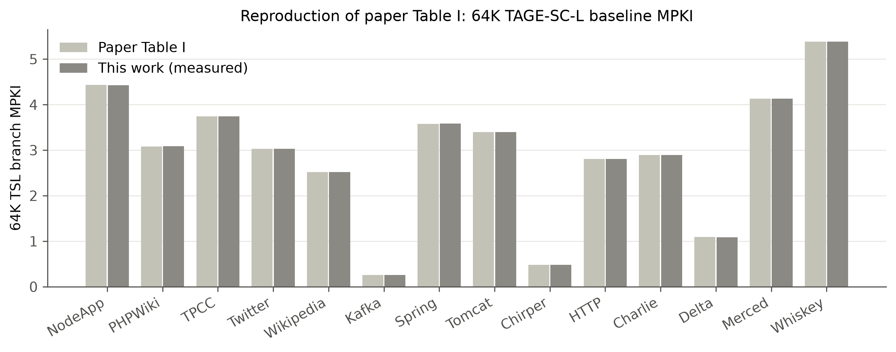

*Figure 4. 64K TSL MPKI per workload, paper Table I vs. this work.*

## 13.2 Absolute MPKI and accuracy

*Table 4. Conditional-branch MPKI (100 M warm-up + 200 M measured instructions). Lower is better. "Mean" is the arithmetic mean.*

| workload | 64K TSL | LLBP | LLBP-X | LLBP-X Opt-W | 512K TSL | LLBP-0Lat | LLBP-X-0Lat |
|---|---|---|---|---|---|---|---|
| NodeApp | 4.425 | 3.318 | 3.234 | 3.175 | 2.384 | 3.227 | 3.165 |
| PHPWiki | 3.085 | 2.776 | 2.734 | 2.829 | 2.034 | 2.560 | 2.617 |
| TPCC | 3.744 | 3.337 | 3.196 | 3.155 | 2.515 | 3.287 | 3.150 |
| Twitter | 3.031 | 2.965 | 2.880 | 2.877 | 2.523 | 2.940 | 2.866 |
| Wikipedia | 2.519 | 2.369 | 2.273 | 2.282 | 1.871 | 2.299 | 2.261 |
| Kafka | 0.261 | 0.236 | 0.226 | 0.226 | 0.175 | 0.233 | 0.220 |
| Spring | 3.581 | 3.256 | 2.844 | 2.743 | 2.121 | 3.237 | 2.760 |
| Tomcat | 3.396 | 3.208 | 3.139 | 3.123 | 2.715 | 3.164 | 3.109 |
| Chirper | 0.483 | 0.450 | 0.427 | 0.430 | 0.329 | 0.442 | 0.417 |
| HTTP | 2.809 | 2.739 | 2.661 | 2.664 | 2.384 | 2.705 | 2.639 |
| Charlie | 2.891 | 2.762 | 2.707 | 2.672 | 2.286 | 2.737 | 2.683 |
| Delta | 1.085 | 1.089 | 1.070 | 1.064 | 0.948 | 1.082 | 1.063 |
| Merced | 4.132 | 3.499 | 3.392 | 3.359 | 2.584 | 3.506 | 3.301 |
| Whiskey | 5.384 | 5.161 | 5.121 | 5.040 | 4.720 | 5.121 | 5.099 |
| Mean | 2.916 | 2.655 | 2.564 | 2.546 | 2.114 | 2.610 | 2.525 |

*Table 5. Conditional-branch prediction accuracy (%). Higher is better.*

| workload | 64K TSL | LLBP | LLBP-X | LLBP-X Opt-W | 512K TSL |
|---|---|---|---|---|---|
| NodeApp | 96.935 | 97.702 | 97.760 | 97.801 | 98.349 |
| PHPWiki | 97.974 | 98.176 | 98.204 | 98.142 | 98.664 |
| TPCC | 97.551 | 97.817 | 97.909 | 97.936 | 98.355 |
| Twitter | 98.093 | 98.135 | 98.189 | 98.190 | 98.413 |
| Wikipedia | 98.232 | 98.337 | 98.405 | 98.398 | 98.687 |
| Kafka | 99.790 | 99.810 | 99.819 | 99.819 | 99.859 |
| Spring | 97.874 | 98.067 | 98.312 | 98.372 | 98.741 |
| Tomcat | 97.799 | 97.921 | 97.966 | 97.976 | 98.240 |
| Chirper | 99.648 | 99.672 | 99.689 | 99.686 | 99.760 |
| HTTP | 98.091 | 98.138 | 98.191 | 98.189 | 98.379 |
| Charlie | 98.119 | 98.203 | 98.239 | 98.261 | 98.512 |
| Delta | 99.066 | 99.062 | 99.079 | 99.084 | 99.184 |
| Merced | 97.401 | 97.799 | 97.866 | 97.886 | 98.374 |
| Whiskey | 96.629 | 96.769 | 96.794 | 96.845 | 97.045 |
| Mean | 98.086 | 98.258 | 98.316 | 98.328 | 98.612 |

## 13.3 MPKI reduction over 64K TSL: Fig. 12

*Table 6. MPKI reduction (%) relative to 64K TSL. Last rows: aggregate statistics.*

| workload | LLBP | LLBP-X | LLBP-X Opt-W | 512K TSL | LLBP-0Lat | LLBP-X-0Lat |
|---|---|---|---|---|---|---|
| NodeApp | 25.03 | 26.92 | 28.26 | 46.13 | 27.08 | 28.47 |
| PHPWiki | 10.00 | 11.38 | 8.30 | 34.06 | 17.00 | 15.15 |
| TPCC | 10.88 | 14.65 | 15.74 | 32.82 | 12.22 | 15.87 |
| Twitter | 2.19 | 5.00 | 5.09 | 16.76 | 3.00 | 5.43 |
| Wikipedia | 5.92 | 9.75 | 9.39 | 25.70 | 8.73 | 10.24 |
| Kafka | 9.58 | 13.56 | 13.56 | 33.07 | 10.65 | 15.56 |
| Spring | 9.08 | 20.58 | 23.40 | 40.78 | 9.62 | 22.92 |
| Tomcat | 5.54 | 7.58 | 8.05 | 20.06 | 6.83 | 8.46 |
| Chirper | 6.77 | 11.57 | 10.87 | 31.99 | 8.59 | 13.60 |
| HTTP | 2.49 | 5.27 | 5.15 | 15.11 | 3.70 | 6.04 |
| Charlie | 4.48 | 6.37 | 7.57 | 20.92 | 5.34 | 7.20 |
| Delta | -0.38 | 1.36 | 1.93 | 12.68 | 0.29 | 2.00 |
| Merced | 15.31 | 17.91 | 18.69 | 37.45 | 15.15 | 20.10 |
| Whiskey | 4.14 | 4.89 | 6.40 | 12.34 | 4.89 | 5.29 |
| Mean (reduction of mean MPKI) | 8.97 | 12.06 | 12.70 | 27.52 | 10.50 | 13.41 |
| AvgRed (mean of per-workload reductions) | 7.93 | 11.20 | 11.60 | 27.13 | 9.51 | 12.60 |
| Min | -0.38 | 1.36 | 1.93 | 12.34 | 0.29 | 2.00 |
| Max | 25.03 | 26.92 | 28.26 | 46.13 | 27.08 | 28.47 |

## 13.4 LLBP-X vs. original LLBP

*Table 7. MPKI improvement (%) of LLBP-X over LLBP.*

| workload | LLBP->LLBP-X | LLBP-0Lat->LLBP-X-0Lat | LLBP->LLBP-X Opt-W |
|---|---|---|---|
| NodeApp | 2.53 | 1.90 | 4.31 |
| PHPWiki | 1.53 | -2.23 | -1.89 |
| TPCC | 4.23 | 4.17 | 5.45 |
| Twitter | 2.88 | 2.51 | 2.96 |
| Wikipedia | 4.07 | 1.65 | 3.68 |
| Kafka | 4.41 | 5.49 | 4.41 |
| Spring | 12.65 | 14.71 | 15.76 |
| Tomcat | 2.16 | 1.75 | 2.66 |
| Chirper | 5.15 | 5.48 | 4.40 |
| HTTP | 2.85 | 2.43 | 2.73 |
| Charlie | 1.98 | 1.96 | 3.23 |
| Delta | 1.74 | 1.72 | 2.30 |
| Merced | 3.07 | 5.84 | 3.99 |
| Whiskey | 0.78 | 0.42 | 2.35 |
| Mean (reduction of mean MPKI) | 3.40 | 3.24 | 4.11 |
| AvgRed (mean of per-workload reductions) | 3.57 | 3.41 | 4.02 |
| Min | 0.78 | -2.23 | -1.89 |
| Max | 12.65 | 14.71 | 15.76 |

## 13.5 Optimisation breakdown (ablation)

*Table 8. Ablation of the two optimisations, prefetch latency modelled (Mean row = arithmetic-mean MPKI). "depth only" = range selection disabled; "range only" = depth adaptation disabled.*

| Workload | LLBP MPKI | depth only | range only | LLBP-X | red. depth only (%) | red. range only (%) | red. full (%) |
|---|---|---|---|---|---|---|---|
| NodeApp | 3.318 | 3.225 | 3.396 | 3.234 | 2.80 | -2.36 | 2.53 |
| PHPWiki | 2.776 | 2.748 | 2.814 | 2.734 | 1.00 | -1.36 | 1.53 |
| TPCC | 3.337 | 3.244 | 3.271 | 3.196 | 2.77 | 1.98 | 4.23 |
| Twitter | 2.965 | 2.902 | 2.881 | 2.880 | 2.11 | 2.84 | 2.88 |
| Wikipedia | 2.369 | 2.295 | 2.308 | 2.273 | 3.15 | 2.58 | 4.07 |
| Kafka | 0.236 | 0.227 | 0.222 | 0.226 | 3.81 | 6.06 | 4.41 |
| Spring | 3.256 | 2.818 | 3.266 | 2.844 | 13.45 | -0.30 | 12.65 |
| Tomcat | 3.208 | 3.162 | 3.192 | 3.139 | 1.44 | 0.52 | 2.16 |
| Chirper | 0.450 | 0.432 | 0.436 | 0.427 | 4.06 | 3.06 | 5.15 |
| HTTP | 2.739 | 2.675 | 2.666 | 2.661 | 2.33 | 2.64 | 2.85 |
| Charlie | 2.762 | 2.720 | 2.698 | 2.707 | 1.50 | 2.32 | 1.98 |
| Delta | 1.089 | 1.079 | 1.066 | 1.070 | 0.92 | 2.16 | 1.74 |
| Merced | 3.499 | 3.407 | 3.367 | 3.392 | 2.64 | 3.76 | 3.07 |
| Whiskey | 5.161 | 5.139 | 5.076 | 5.121 | 0.43 | 1.65 | 0.78 |
| Mean | 2.655 | 2.577 | 2.618 | 2.564 | 2.94 | 1.36 | 3.40 |

Incremental attribution on mean MPKI: depth adaptation **86.4 %**, history range selection **13.6 %** of the LLBP→LLBP-X reduction (paper §VII-E: 82 % / 18 %).

## 13.6 Pattern-store transfer bandwidth

*Table 9. Pattern-store ↔ pattern-buffer traffic in bits per instruction (288 bits per pattern-set read or dirty write-back).*

| workload | LLBP | LLBP-X | LLBP-X Opt-W |
|---|---|---|---|
| NodeApp | 15.20 | 14.72 | 13.28 |
| PHPWiki | 16.20 | 15.41 | 14.79 |
| TPCC | 14.95 | 13.61 | 11.74 |
| Twitter | 12.92 | 12.30 | 10.16 |
| Wikipedia | 9.98 | 9.35 | 8.09 |
| Kafka | 9.68 | 8.56 | 5.54 |
| Spring | 8.06 | 7.74 | 6.39 |
| Tomcat | 12.00 | 11.08 | 10.83 |
| Chirper | 7.15 | 7.94 | 6.72 |
| HTTP | 12.51 | 13.37 | 10.91 |
| Charlie | 6.87 | 6.43 | 5.52 |
| Delta | 3.94 | 4.82 | 3.47 |
| Merced | 5.67 | 5.41 | 4.12 |
| Whiskey | 5.57 | 4.95 | 4.55 |
| Mean | 10.05 | 9.69 | 8.29 |

## 13.7 gem5 integration check

The official gem5 models were patched into gem5 (commit `51759b5`) and the ARM `gem5.opt` binary was built. The artifact's SE-mode hello-world test was run with each predictor on a detailed O3 core.

*Table 10. gem5 hello-world (SE mode, ARM, O3 CPU). Source: `results/gem5/<model>/stats.txt`.*

| gem5 model | Predictor configuration | Instructions | Cond. lookups | Mispredictions | IPC |
|---|---|---|---|---|---|
| TSL64k | TAGE-SC-L 64 KB | 5,208 | 2,003 | 58 | 0.1364 |
| LLBP | LLBP, depth adaptation off | 5,208 | 2,003 | 58 | 0.1364 |
| LLBPX | LLBP model with `adaptCtxDepth=true`, 6K-entry CTT | 5,208 | 2,003 | 58 | 0.1364 |

All three runs completed and printed "Hello world!". Each reported 58 mispredictions, against "around 56" in the artifact documentation. This confirms that the gem5 integration works. With only 5 K instructions, the program is far too short for the second-level predictor to matter, so these numbers say nothing about accuracy or speedup differences.

# 14. Graphical Comparison

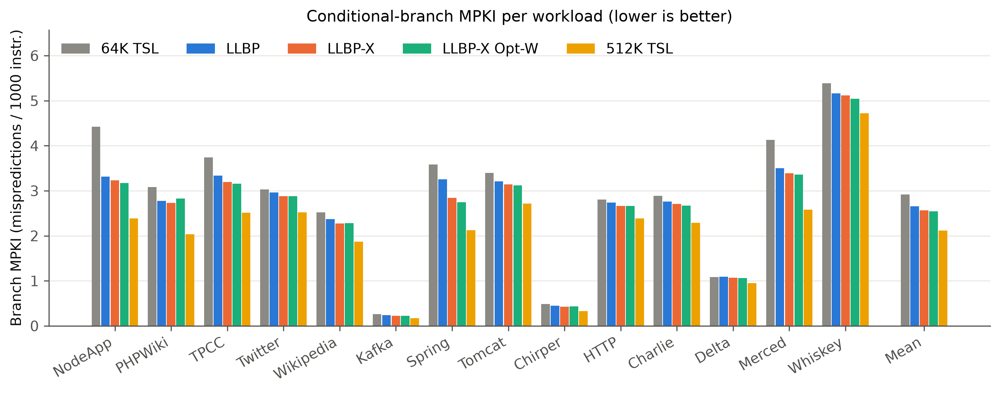

*Figure 5. Absolute branch MPKI of 64K TSL, LLBP, LLBP-X, LLBP-X Opt-W and the ideal 512K TSL.*

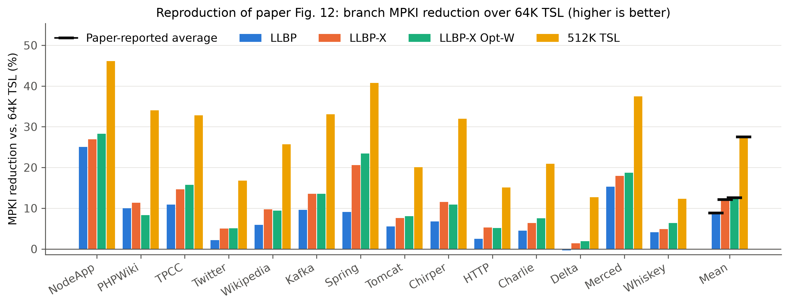

*Figure 6. Reproduction of paper Fig. 12: MPKI reduction over 64K TSL. Black ticks on the Mean group mark the averages reported in the paper (8.8 %, 12.1 %, 12.6 %, 27.5 %); our values are 8.97 %, 12.06 %, 12.70 % and 27.52 %.*

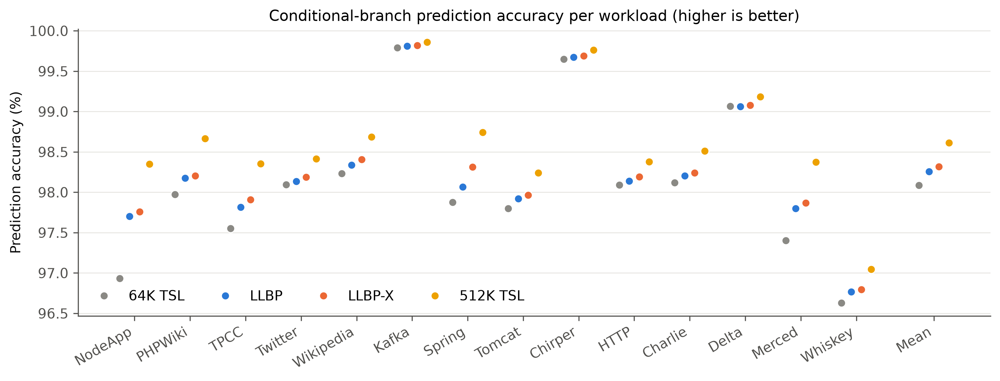

*Figure 7. Conditional-branch prediction accuracy per workload (dot plot; the axis does not start at zero).*

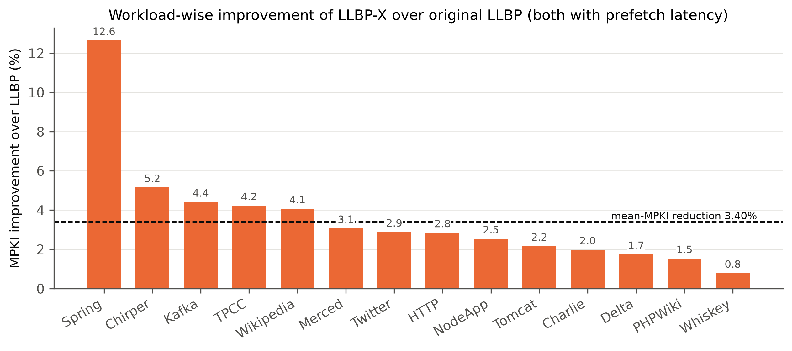

*Figure 8. Per-workload MPKI improvement of LLBP-X over LLBP, sorted. No workload regresses.*

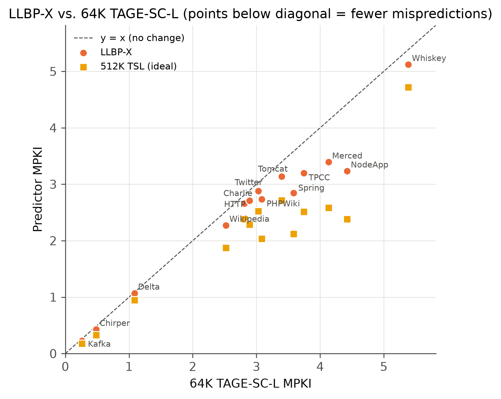

*Figure 9. LLBP-X and 512K TSL MPKI against the 64K TSL baseline. Points below the diagonal have fewer mispredictions than the baseline.*

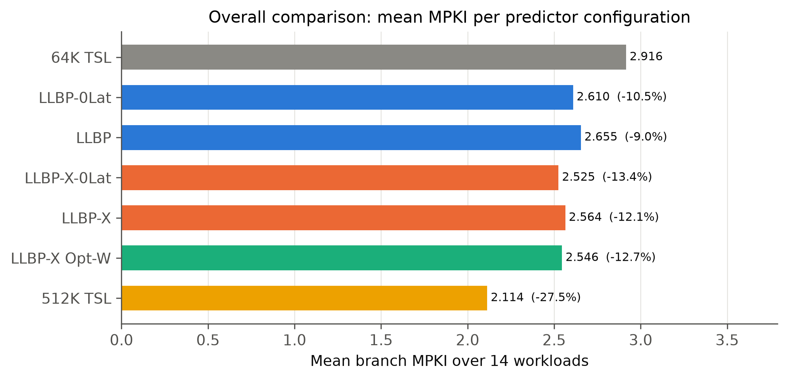

*Figure 10. Mean MPKI per predictor configuration, with the reduction relative to 64K TSL.*

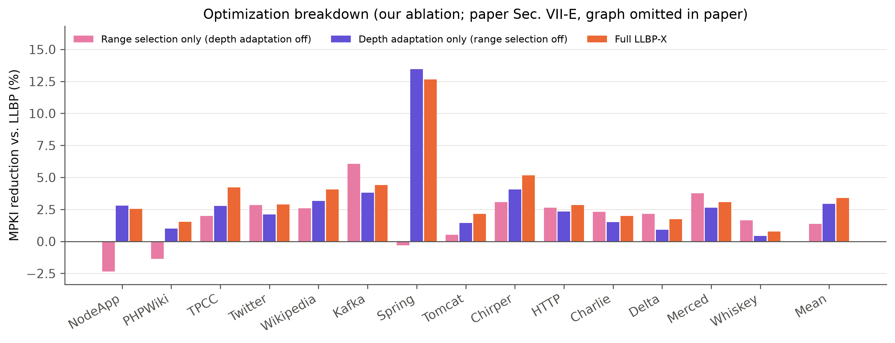

*Figure 11. Optimisation breakdown: MPKI reduction relative to LLBP for range selection only, depth adaptation only and full LLBP-X (latency modelled).*

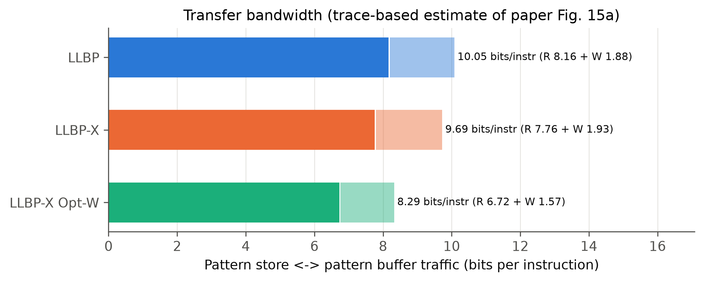

*Figure 12. Mean pattern-store transfer bandwidth, split into reads and writes (trace-based estimate of paper Fig. 15a).*

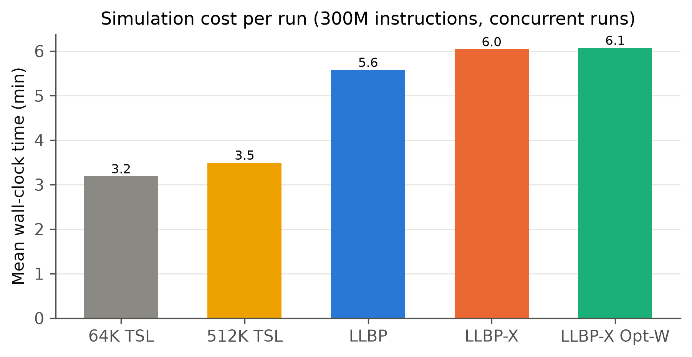

*Figure 13. Mean simulation wall-clock time per 300 M-instruction run (concurrent runs on a 17-vCPU VM). This is a property of the simulator, not of the predictors.*

# 15. Performance Analysis

**Accuracy and MPKI.** Among realisable designs, LLBP-X has the lowest mean MPKI (2.564) and the highest accuracy (98.32 %). Only the oracle Opt-W variant (2.546) and the unrealisable 512K TSL (2.114) do better. LLBP-X reduces the mean MPKI of 64K TSL by **12.06 %**, against 8.97 % for LLBP, and it improves over both on all 14 workloads.

**Improvement over LLBP.** The per-workload improvement ranges from 0.78 % (Whiskey) to 12.65 % (Spring), with an average of **3.57 %** (paper: 0.8–11.5 %, average 3.6 %). The TSL-relative gain grows from 8.97 % to 12.06 %, i.e. by 34.5 % (paper: "36 % average improvement over the original design"). LLBP-X captures 43.8 % of the 64K→512K TSL opportunity, against 32.6 % for LLBP.

**Which workloads benefit.** Spring stands out: LLBP captures only 9 % of a 41 % opportunity there, and depth adaptation alone recovers 13.4 % on top of LLBP. Workloads with large capacity headroom (NodeApp, TPCC, Merced, Spring) see the largest absolute reductions. The Google traces Whiskey, Delta and Charlie, whose 512K-TSL headroom is small, gain least. The improvement over LLBP is moderately correlated with the 512K-TSL headroom (Pearson r = 0.50).

**Consistency.** The sign is consistent (14/14 with latency modelled); the magnitude is not (standard deviation 2.9 pp). Without Spring, the average improvement over LLBP drops from 3.57 % to 2.87 %. In the 0-latency configuration, LLBP-X is 2.2 % *worse* than LLBP on PHPWiki, so the benefit is not guaranteed in every configuration.

**Contribution of the two optimisations.** With incremental attribution (LLBP → depth adaptation → range selection) on mean MPKI, **dynamic context depth adaptation accounts for 86.4 %** of the LLBP→LLBP-X reduction and **history range selection for 13.6 %** (77 % / 23 % without latency). The paper reports 82 % / 18 %. Two observations refine this:

1. Depth adaptation is essential on H2P-heavy workloads. Without it, LLBP-X is worse than LLBP on NodeApp (−2.4 %), PHPWiki (−1.4 %) and Spring (−0.3 %).
2. On five workloads (Charlie, Delta, Kafka, Merced, Whiskey), the configuration *without* depth adaptation, i.e. every context shallow, beats full LLBP-X. For these programs the patterns lost on each W switch outweigh the capacity gained. This supports the paper's statement that switching cost limits the benefit of adaptation.

**Latency sensitivity.** Modelling the pattern-store latency costs LLBP 1.81 % and LLBP-X 1.67 % in MPKI on average, so LLBP-X's benefit holds up when latency is modelled.

**Bandwidth.** LLBP-X lowers the average transfer bandwidth from 10.05 to 9.69 bits/instruction (−3.6 %), with reads dominating (80 %). The paper's gem5 measurement is 10.6 → 9.9 (−6.1 %). The direction and magnitude agree, although our trace model has no wrong-path prefetches. LLBP-X uses *more* bandwidth than LLBP on Chirper, HTTP and Delta.

# 16. Discussion

**Fidelity of the reproduction.** The official artifact reproduces the paper's accuracy results almost exactly: Table I to within rounding, and the Fig. 12 averages to within 0.2 pp. The README warns that results "might slightly differ" because the paper used a ChampSim integration. Our evidence suggests that, at least for the averages and ranges reported in the text, the CBP-style simulator gives practically the same numbers. Two indications:

* The Charlie and Whiskey traces are shorter than the 300 M instructions simulated. The simulator therefore wraps around and the last 30–65 M ROI instructions are re-executions on a warm predictor. Our 64K TSL MPKI on these traces matches the paper to three digits, so the paper's numbers evidently include the same wrap-around. This is a methodological weakness of the official setup that the paper does not mention; it likely flatters the predictors slightly on those two traces.
* The few differences we see are at the extremes of the ranges: LLBP's minimum (Delta, −0.38 % vs 0.6 %) and LLBP-X's maximum gain over LLBP (Spring, 12.65 % vs 11.5 %).

**Trace prefixes.** Network constraints forced us to use the first 1–1.5 GiB of each trace rather than the complete file. Because the simulator reads traces sequentially and stops after 300 M instructions, this has no effect on results as long as the prefix contains 300 M instructions. Two prefixes initially did not (Kafka, NodeApp); this was detected by decompressing every prefix before use, and both were extended before simulation. No run on a prefix wrapped.

**Code vs paper.** The paper describes deep contexts reverting to the shallow depth when allocations become short. In the artifact, that branch is unreachable (Section 8.1), so a deep context only reverts when its CTT entry is evicted. Since our results match the paper, the paper's numbers were most likely produced with this behaviour. Making the reversion reachable is a natural experiment for future work.

**Ablation methodology.** Our ablation switches change one mechanism at a time inside the official model, and their default setting reproduces upstream output bit for bit. The shares depend on the attribution order (range-first would give range selection 40 %). We therefore regard the 82 %/18 % claim as consistent with, but not uniquely confirmed by, our data.

# 17. Limitations

1. **No IPC.** The trace-based simulator does not model a pipeline. The paper's speedup results (Fig. 13), prefetch timeliness, false-path and overriding studies (Fig. 14) require its gem5 full-system setup, which is not part of the artifact. gem5 was built with the official LLBP/LLBP-X gem5 models (gem5 commit 51759b5 + `artifact/scripts/llbpx.patch`) and the artifact's SE-mode hello-world test was run for TSL64k, LLBP and LLBP-X: all three completed, printed "Hello world!", and reported 58 conditional-branch mispredictions on 5,208 instructions (artifact README: "around 56"); this verifies the integration but is far too short to measure accuracy or IPC differences.
2. **Energy (Fig. 15b)** requires CACTI models that are not included.
3. **Limit-study and characterisation figures (Figs. 1, 5–9)** require hardware counters on Intel servers or unconstrained model variants not exposed in the artifact.
4. **Sensitivity studies (§VII-F/G, Fig. 16)** were not run, for lack of time; the parameters exist in `LLBPXConfig`.
5. **Trace prefixes** were used for 11 of 14 traces. They contain all instructions simulated, but our trace files are not byte-identical to the complete Zenodo files (SHA-256 of the bytes used: `logs/trace_manifest.csv`).
6. **Short Google traces** (Charlie, Whiskey) are repeated by the official simulator within the measured region; we kept this behaviour for comparability with the paper and labelled those runs.
7. **Single run per configuration.** The simulator is deterministic, so there is no run-to-run variance; however, results are for one 200 M-instruction region per workload.
8. **Same 14 workloads used for tuning and evaluation** in the original work; we could not evaluate on independent workloads.

# 18. Conclusion

We reproduced the trace-based evaluation of LLBP-X with the authors' official artifact on all 14 server traces and the paper's methodology. The baseline is reproduced exactly (Table I within ±0.005 MPKI), and the headline result is confirmed. LLBP-X reduces branch MPKI over a 64 KB TAGE-SC-L by **12.06 %** on average (paper: 12.1 %), against 8.97 % for the original LLBP, and improves over LLBP on every workload by 0.78–12.65 % (average **3.57 %**; paper: 3.6 %). An ablation we added to the official model shows that **dynamic context depth adaptation provides most of the gain (≈ 86 %)** and history range selection the rest (≈ 14 %), consistent with the paper's 82 %/18 %. It also shows that adaptation hurts on workloads with flat branch working sets, where an all-shallow configuration would be better. Even so, LLBP-X recovers only 44 % of the improvement of an ideal, equally sized 512 KB TAGE-SC-L. Closing that gap remains open.

# 19. Future Scope

* **Make the deep→shallow reversion reachable** and measure its effect; tune the hysteresis.
* **Workload-adaptive enabling** of depth adaptation, since an all-shallow configuration wins on five workloads.
* **Sensitivity studies** (H<sub>th</sub>, T<sub>max</sub>, CTT size, pattern-store size, smaller base TAGE) using the existing `LLBPXConfig` parameters.
* **Full-length evaluation** with complete traces and multiple simulation regions (SimPoints) per workload, avoiding wrap-around on short traces.
* **Timing evaluation in gem5** with full-system server workloads to measure IPC, prefetch timeliness and energy.
* **More than two depths, or soft migration** of patterns between depths, to reduce the switching cost.

# References

[1] D. Schall, M. Ďuračková, B. Grot, "The Last-Level Branch Predictor Revisited," in *Proc. 32nd IEEE Int. Symp. on High-Performance Computer Architecture (HPCA)*, 2026. Artifact: <https://github.com/dhschall/LLBP-X>, DOI 10.5281/zenodo.17807918.

[2] D. Schall, A. Sandberg, B. Grot, "The Last-Level Branch Predictor," in *Proc. 57th IEEE/ACM Int. Symp. on Microarchitecture (MICRO)*, 2024.

[3] A. Seznec, P. Michaud, "A case for (partially) TAgged GEometric history length branch prediction," *J. Instruction-Level Parallelism*, vol. 8, 2006.

[4] A. Seznec, "TAGE-SC-L branch predictors again," in *5th JILP Workshop on Computer Architecture Competitions (CBP-5)*, 2016.

[5] D. A. Jiménez, "Reconsidering complex branch predictors," in *Proc. HPCA*, 2003.

[6] A. Seznec, S. Felix, V. Krishnan, Y. Sazeides, "Design tradeoffs for the Alpha EV8 conditional branch predictor," in *Proc. ISCA*, 2002.

[7] A. Seznec, A. Fraboulet, "Effective ahead pipelining of instruction block address generation," in *Proc. ISCA*, 2003.

[8] L. Cai, A. Deshmukh, Y. Patt, "Enabling ahead prediction with practical energy constraints," in *Proc. ISCA*, 2025.

[9] T. A. Khan et al., "Whisper: Profile-guided branch misprediction elimination for data center applications," in *Proc. MICRO*, 2022.

[10] S. Zangeneh, S. Pruett, S. Lym, Y. N. Patt, "BranchNet: A convolutional neural network to predict hard-to-predict branches," in *Proc. MICRO*, 2020.

[11] S. Pruett, Y. N. Patt, "Branch runahead: An alternative to branch prediction for impossible to predict branches," in *Proc. MICRO*, 2021.

[12] DynamoRIO, "Google workload traces," 2024. <https://dynamorio.org/google_workload_traces.html>

[13] D. Schall, "Server traces for the Last-Level Branch Predictor," Zenodo, DOI 10.5281/zenodo.13133242.

[14] J. Lowe-Power et al., "The gem5 simulator: Version 20.0+," arXiv:2007.03152, 2020.

# Appendix A. Reproducing this report

```bash
scripts/run_experiments.sh -j 12          # 154 simulations
.venv/bin/python scripts/parse_results.py
.venv/bin/python scripts/make_figures.py
.venv/bin/python scripts/make_diagrams.py
.venv/bin/python scripts/assemble_report.py   # builds this Markdown file from REPORT/part*.md + tables
.venv/bin/python scripts/build_report_pdf.py
```

# Appendix B. Contribution statement

| Item | Original authors | This project |
|---|---|---|
| LLBP / LLBP-X / TAGE-SC-L models, simulator, gem5 models, Opt-W tables | ✔ | reused unchanged |
| ROI accuracy output, ablation switches (90 lines, `src/patches/`) | | ✔ |
| Experiment driver, parser, figures, PDF, trace downloader, validation | | ✔ |
| All experiments, analysis and documentation | | ✔ |
